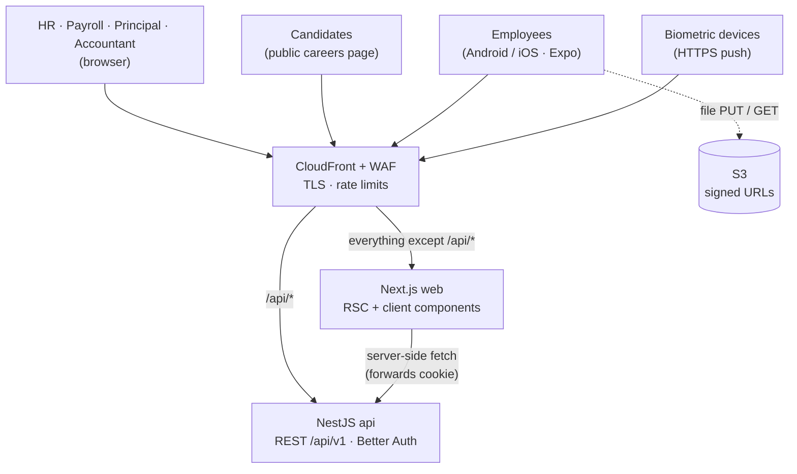
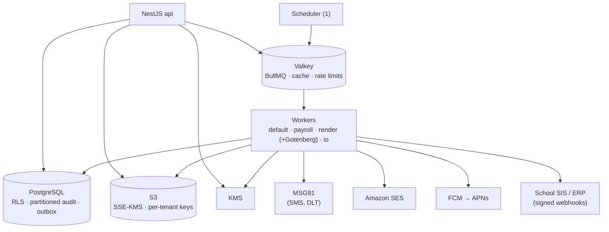
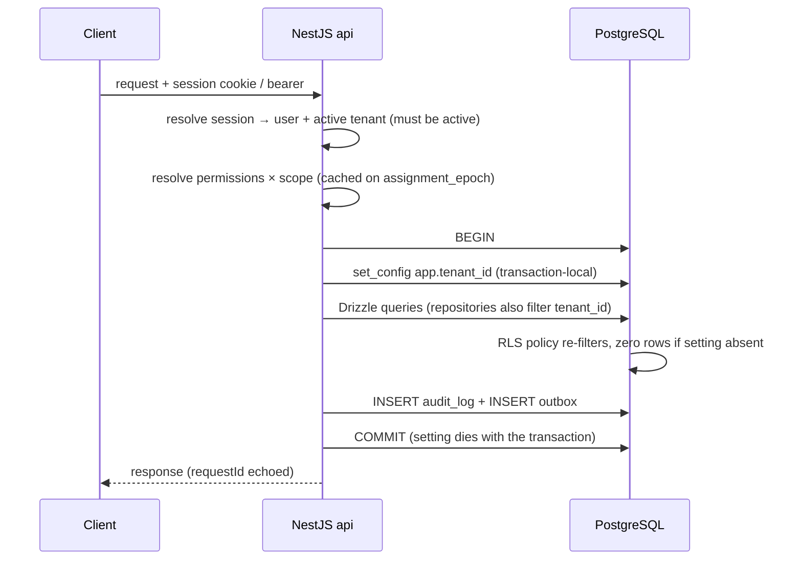
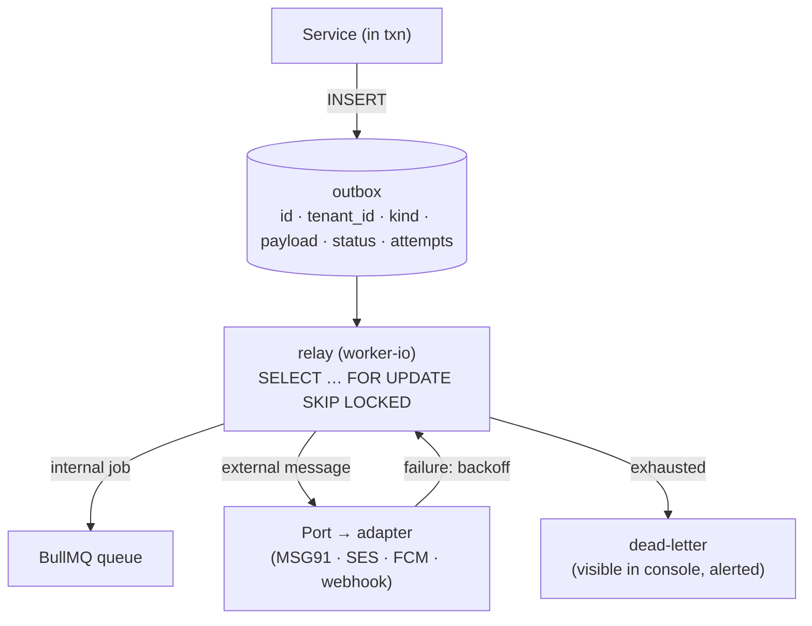
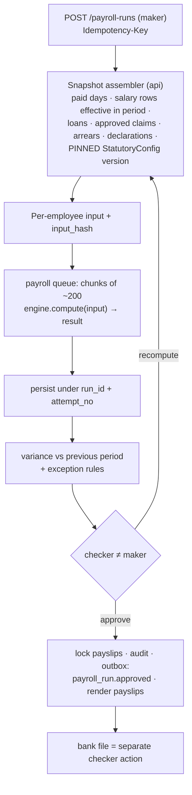
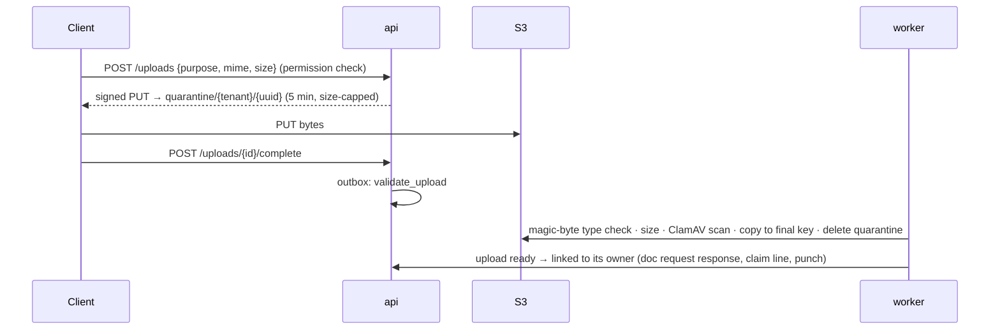
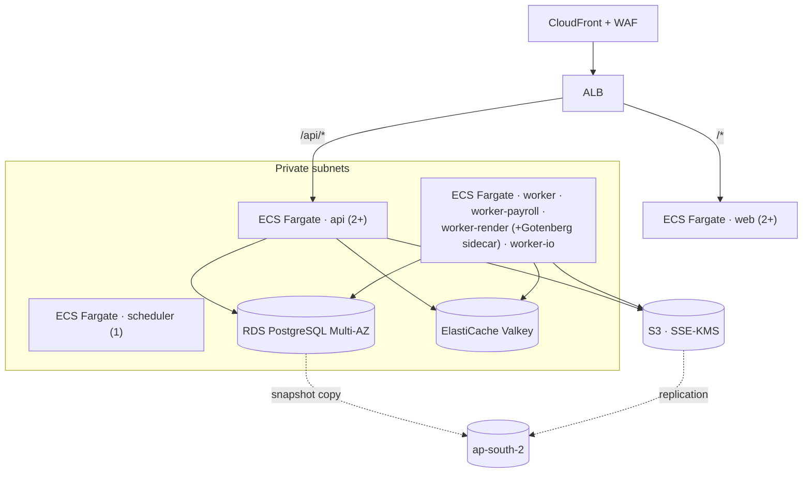

# Naveya — System Architecture & Tech Stack

> **Status:** BASELINE for the production build (2026-11-09). Written to be copied into the new
> production repository as `docs/architecture.md`. The prototype repo (`navya/`) remains the reference
> for product scope (`development-specification.md`, `functional-specs/`) and visual design
> (`DESIGN.md`, `design/v3`).
>
> **Decided:** TypeScript end-to-end — **NestJS backend**, Next.js web, Expo mobile, one pnpm monorepo.
> This supersedes the prototype's Django + strawberry-GraphQL + Flutter stack.
> **Still open:** the items in §27 *Decisions needed*. Where this document assumes an answer it says so.

---

## Contents

§1 Product in one page · §2 Constraints · §3 Capacity estimate · §4 Architecture style ·
§5 Container view · §6 Repository layout · §7 Backend internals · §8 Tenancy enforcement ·
§9 Identity, sessions & authorization · §10 API design · §11 Background jobs & the outbox ·
§12 Payroll engine · §13 Money · §14 Files · §15 Notifications & integrations · §16 Statutory filings ·
§17 Biometric ingestion · §18 Web app · §19 Mobile app & offline sync · §20 Data architecture ·
§21 Security & compliance · §22 Observability · §23 Deployment · §24 Failure modes ·
§25 Testing strategy · §26 Tech stack summary · §27 Decisions needed · §28 First milestones

---

## 1 · Product in one page

**Naveya** is a multi-tenant HR & payroll SaaS for Indian educational institutions, private multi-branch
K-12 groups first, with a single-tenant on-premise option. Modules (spec M1–M17): organization &
tenancy, identity & roles, core HR, document governance, recruitment/ATS, onboarding, academic calendar,
leave, attendance, payroll (incl. loans, reimbursements, arrears), statutory compliance (PF/ESI/PT/TDS/
gratuity/bonus/LWF + filings), full & final settlement, employee self-service mobile app, notifications,
reporting + helpdesk, integrations, performance appraisal.

**Surfaces:** a web console for HR, payroll, accountants, principals and directors; a phone-first app for
employees (leave, attendance punch, payslips, document-request responses, claims, tickets); a public
careers page; device and ERP integrations.

**Non-negotiables carried from the spec** (each is designed for below, not left to discipline):
tenant isolation enforced by the database · money is decimal, never float · statutory rates live in
versioned, effective-dated `StatutoryConfig`, never in code · maker-checker on payroll runs, bank files,
filings, payout batches, arrears and bonus runs · append-only audit · employees cannot write their own
documents (only respond to HR requests) · no PII in logs · Hindi + English everywhere.

---

## 2 · Constraints

| # | Constraint | Consequence |
|---|---|---|
| C1 | **~2 engineers + AI agents** | One language, one repo, one deployable backend, managed services. No microservices, no Kubernetes. |
| C2 | **Payroll/statutory output must be correct and reproducible** | Pure, deterministic compute core; decimal math only; config pinned per run; idempotent actions; golden-file tests. |
| C3 | **Tenant isolation cannot fail** | Shared schema + Postgres row-level security that fails closed, below the ORM. |
| C4 | **Same build runs SaaS and on-prem** | No cloud-proprietary dependency inside the app; every external service sits behind a port with an S3- / SMTP- / Postgres-compatible substitute. |
| C5 | **Staff PII under Indian law** (DPDP Act 2023 + Rules; CERT-In 2022 directions) | India-region hosting, field-level encryption, PII-free logs retained 180 days in India, append-only audit. |
| C6 | **Phone-first users on weak campus networks** | Offline-capable capture; server-authoritative sync; small payloads. |
| C7 | **Hindi + English**, including server-rendered PDFs and SMS | PDF engine must shape Devanagari; SMS templates DLT-registered; API returns codes, not prose. |
| C8 | **Load is spiky and calendar-driven** | Design for the morning punch burst and month-end payroll week, not sustained high QPS. |

---

## 3 · Capacity estimate

**Assumptions (unconfirmed — §27 D-6):** year 1 ≈ 100 tenants averaging 500 staff (~50k employees);
largest tenant ≈ 2,000 staff.

| Quantity | Estimate | Implication |
|---|---|---|
| Attendance punches | ~100k/day; ~2.6M rows/month | Trivial for Postgres; partition by month only past ~100M rows. |
| Morning burst | ~70% of punches in one hour → ~20 writes/s | Ingest acks fast, reconciles async. |
| Interactive load | ~2,500 concurrent users → ~250 req/s peak | 2–4 small API containers. The database is the scaling concern, not Node. |
| Payroll compute, largest tenant | 2,000 employees × ~5–20 ms ≈ seconds to a minute | One worker suffices. Chunking is for **resumability**, not speed. |
| Payslip PDFs | ~50k/month, over 3–4 days | Dedicated render queue + Gotenberg; off the interactive path. |
| Object storage | ~400 GB documents + ~60 GB/yr payslips | S3, never the database. |
| Database | < 100 GB in year 1 (audit log largest) | One primary, scaled vertically. Partition audit from day one. |

**Conclusion:** invest in correctness, isolation and operability — not horizontal scale.

---

## 4 · Architecture style — a modular monolith

**One backend codebase (`apps/api`), one container image, several process roles.** Modules are NestJS
modules with enforced boundaries, not services. Payroll needs attendance, leave, salary, loans, claims
and statutory config in one consistent snapshot — a single Postgres transaction gives that for free;
microservices would turn it into a distributed-consistency problem with no team to own it. Isolation
where it matters (long payroll jobs, PDF rendering, vendor I/O) comes from **process role + queue**.

### 4.1 Process roles

| Role | Entry point | Runs | Scale |
|---|---|---|---|
| `api` | `main.http.ts` | NestJS on Fastify: REST `/api/v1`, auth, device ingest, webhooks in | request rate (2+) |
| `worker` | `main.worker.ts` with `WORKER_QUEUES=default` | approvals, reconciliation, upload validation, domain reactions | queue depth |
| `worker-payroll` | `WORKER_QUEUES=payroll` | payroll / arrears / bonus / F&F compute; concurrency 1–2, long locks | rarely (1–2) |
| `worker-render` | `WORKER_QUEUES=render` + **Gotenberg** sidecar + JRE | payslips, Form 16, letters, Excel exports, 24Q FVU validation | month-end depth |
| `worker-io` | `WORKER_QUEUES=io` | outbox relay → SMS / email / push / outbound webhooks | provider latency |
| `scheduler` | `main.scheduler.ts` | registers BullMQ job schedulers; per-tenant fan-out of scans | exactly 1 |
| `migrate` | `pnpm db:migrate` | one-shot release step before new `api` tasks start | — |
| `web` | Next.js | the console (separate image, `apps/web`) | 2+ |

All backend roles share one image; `worker-render` adds a JRE layer and runs next to a Gotenberg
container.

---

## 5 · Container view

### 5.1 Who talks to Naveya, and through what



### 5.2 Inside the region: processes, data and vendors



**Same-origin web:** CloudFront routes `/api/*` to the API and everything else to Next.js, so the
browser sees one origin. The session lives in an httpOnly cookie set by the API; there is no token in
JavaScript, no CORS, and no separate auth layer in Next.js. Server Components call the API over the
internal network, forwarding the cookie.

**Mobile** calls the API directly with a bearer session token held in the OS keystore.

---

## 6 · Repository layout

One **pnpm workspace + Turborepo** monorepo.

```
naveya/
  apps/
    api/                      NestJS backend (all backend process roles)
      src/
        main.http.ts  main.worker.ts  main.scheduler.ts
        platform/             tenancy, db, auth wiring, audit, idempotency, outbox, logging, errors
        modules/
          org/ iam/ people/ documents/ ats/ onboarding/ calendar/ leave/ attendance/
          payroll/ statutory/ settlement/ ess/ notifications/ reporting/ helpdesk/ appraisal/
        integrations/
          ports/              SmsSender, Mailer, PushSender, ObjectStore, KeyProvider, PdfRenderer, …
          adapters/           msg91/ ses/ smtp/ fcm/ s3/ kms/ local-keys/ gotenberg/ webhooks/
      test/                   integration tests (Testcontainers)
    web/                      Next.js console
    mobile/                   Expo app
  packages/
    db/                       Drizzle schema, RLS policy definitions, migrations, seed + factories
    contracts/                Zod schemas for every request/response; emits openapi.json
    api-client/               typed client generated from openapi.json (web + mobile)
    payroll-engine/           PURE payroll + statutory calculators (no I/O) + golden files
    money/                    Money type over decimal.js; formatting (₹, Indian grouping)
    i18n/                     EN + HI message catalogs shared by web and mobile
    ui/                       web design system: shadcn/ui components on v3 tokens + Storybook
    config/                   shared tsconfig, eslint, prettier presets
  infra/
    terraform/                staging, prod (AWS)
    compose/                  local dev stack + on-prem bundle
  docs/                       architecture, ADRs, specs, learnings
```

**Dependency rules (enforced by dependency-cruiser in CI):**
- `payroll-engine` and `money` import nothing from `db`, `api`, Node I/O, or the clock.
- `apps/web` and `apps/mobile` never import `db`, `payroll-engine` or anything under `apps/api`.
- A module in `apps/api/src/modules/X` may call module Y only through Y's exported service; never Y's
  repository or tables.
- Vendor SDKs are importable only under `integrations/adapters/`.

---

## 7 · Backend internals (NestJS)

### 7.1 Layering inside every module

```
controller   HTTP only: parse with Zod contract, call one service method, map result. No rules.
   ↓
service      use-case + transaction boundary: permission check, state-machine guard,
             call domain/engine, write via repository, write audit + outbox rows
   ↓
domain       pure functions and types (or packages/payroll-engine for payroll/statutory)
   ↓
repository   Drizzle queries for this module's tables only
```

### 7.2 Cross-cutting plumbing

| Concern | Mechanism |
|---|---|
| Request context | **nestjs-cls** (AsyncLocalStorage) holds `requestId`, `tenantId`, `userId`, `locale`, the active transaction. Available anywhere without parameter threading. |
| Transactions | **@nestjs-cls/transactional** with the Drizzle adapter: a `@Transactional()` service method runs every repository call in one transaction, and that transaction is where the tenant setting lives (§8). *Verify the adapter's maturity in the week-1 spike; fallback is an explicit `db.transaction(tx => …)` passed down.* |
| Validation | Global Zod validation pipe (nestjs-zod) — every body, query and param is parsed; unknown keys rejected. |
| Errors | Global exception filter → RFC 7807 `application/problem+json` with stable `code`, field errors and `requestId`. No user-facing prose from the server. |
| Authorization | `@RequirePermission('leave.approve')` guard + scope resolution (§9.3). |
| Audit | Services call `audit.record(...)` inside the transaction; an interceptor guarantees every mutating route produced at least one audit row in non-production (a test-time assertion). |
| Idempotency | `Idempotency-Key` interceptor on money/statutory/settlement actions (§10). |
| Domain events | An in-process typed event bus for same-transaction reactions (leave approved → mark attendance → flag LOP). Anything leaving the process goes through the outbox (§11). |

---

## 8 · Tenancy enforcement

**Model:** a tenant is a customer account (SaaS) or the single tenant of an on-prem install. The
`group → trust → campus → department` hierarchy lives *inside* a tenant. Every tenant-owned table has
`tenant_id` and a row-level security policy, created in the **same migration** as the table.



#### Rules

1. **Policy shape** (declared with Drizzle `pgPolicy`, plus a hand-written migration step for
   `ALTER TABLE … FORCE ROW LEVEL SECURITY`, which drizzle-kit does not emit):
   `USING (tenant_id = current_setting('app.tenant_id', true)::uuid)` and the same `WITH CHECK`.
2. **The app connects as `naveya_app`**, a non-owner, non-superuser role without `BYPASSRLS`.
   Migrations run as `naveya_owner`. Without this split, RLS does not bind the app.
3. **Transaction-local only.** `set_config(..., true)` / `SET LOCAL`. A session-level `SET` would leak a
   tenant across pooled connections — covered by a named test.
4. **Every tenant-scoped request runs in a transaction.** Read-only requests too (a cheap
   `BEGIN READ ONLY`). Streaming responses use an explicit tenant-context helper.
5. **Fail closed:** no setting → `NULL` predicate → no rows. A forgotten filter cannot widen access.
6. **Jobs carry `tenantId` in job data**; the worker base class opens a transaction and sets it, and
   **throws** if it is missing. Scheduled scans enumerate tenants and enqueue one job per tenant —
   never a cross-tenant query.
7. **Privileged paths** (tenant provisioning, migrations, platform ops) use an explicitly named
   `asPlatform()` connection with its own audit trail; it is the only place RLS is bypassed.
8. **Conformance test:** CI queries `pg_class`/`pg_policies` and fails if any table with a `tenant_id`
   column lacks `relrowsecurity`, `relforcerowsecurity` and a policy. The cross-tenant suite runs raw
   SQL as tenant A and asserts zero tenant-B rows for every table.
9. RLS stays **identical on-prem** (single tenant). There is no flag to disable it.

---

## 9 · Identity, sessions & authorization

### 9.1 Identity — Better Auth, owned by the API

| Need | Better Auth feature |
|---|---|
| Email/password for console users | core |
| Phone OTP for employees | `phoneNumber` plugin; OTP SMS goes through our `SmsSender` port (MSG91, DLT template) |
| TOTP MFA for admin / payroll / accountant roles | `twoFactor` plugin; enforced by role |
| Google Workspace / Microsoft Entra SSO | `sso` / social providers (OIDC) |
| Mobile | `bearer` plugin + `@better-auth/expo` (token in SecureStore) |
| Tenant membership & active tenant | `organization` plugin: organization = tenant; `session.activeOrganizationId` = active tenant |
| Rate limiting of auth endpoints | built-in, backed by Valkey |

**Identity is global, membership is per tenant.** One person has one login; `member` rows bind them to
tenants. The session carries the active tenant; switching tenant is an explicit, audited action.
Better Auth's own tables (`user`, `session`, `account`, `verification`) are platform tables, not
tenant-owned; everything about the person *as an employee* lives in tenant-owned tables.

**Sessions are server-side** (database-backed, short cookie cache). Revocation, forced logout on role
removal, and "log out all devices" are immediate — no 15-minute stale JWT window, which matters for
maker-checker.

*Week-1 spike (§27 D-11): confirm that the organization, phone OTP, 2FA, SSO and Expo plugins compose
cleanly and that the auth tables live in our Drizzle schema. Fallback if they do not: keep Better Auth
for authentication only and own a `tenant_membership` table ourselves.*

### 9.2 Web session safety

Cookie: `HttpOnly; Secure; SameSite=Lax`, host-only on the app domain. State-changing requests require
a matching `Origin` header (Better Auth checks its own routes; a global guard checks ours). Login and OTP
endpoints sit behind both WAF and app rate limits.

### 9.3 Authorization — permission × scope

- `Role` = a named set of permissions (`leave.approve`, `payroll.approve`, `people.pii.read`, …).
- `RoleAssignment` = user × role × scope (`group` / `campus` / `department` + id), tenant-owned.
- Resolved **per request** on the server and cached in Valkey keyed by the user's `assignment_epoch`
  (bumped on any grant or revoke).
- Repositories receive the caller's scope set and filter to it; **RLS handles tenant, the app handles
  scope** (scope rules are too rich for policies and change too often).
- **Field-level PII** (bank, PAN, Aadhaar-last-4, salary) is a separate permission; serializers return
  `null` + `masked: true` when absent.
- **Maker-checker** is a service-layer state-machine guard: `approve()` refuses when
  `actor === record.createdBy`. Bank-file generation is its own checker-gated action. F&F is the one
  tenant-configurable exception (spec M12).
- **Document governance:** the Employee role has no `documents.write`; the only employee path is
  responding to an open `DocumentUpdateRequest`. Enforced in the service, tested at the API.

---

## 10 · API design

| Topic | Convention |
|---|---|
| Style | REST, resource-oriented, under `/api/v1`. State transitions are explicit action endpoints: `POST /payroll-runs/{id}/approve`, not a PATCH of `status`. |
| Contract | Zod schemas in `packages/contracts` are the source of truth → **`openapi.json` generated and committed** → `packages/api-client` generated (`openapi-typescript` + `openapi-fetch`). CI fails when the committed spec or client drifts. |
| Why Zod + OpenAPI | Zod gives runtime validation on the server and form validation on both clients from one definition; OpenAPI serves ERP/SIS integrators and any non-TS client. |
| Tenancy | Implicit from the session. Never a parameter a client can set. |
| Money on the wire | **Strings** (`"45250.00"`), validated by a `MoneyString` Zod schema. Never JSON numbers. |
| Dates | ISO 8601; date-only fields as `YYYY-MM-DD`; timestamps UTC; campus time zone applied at the edge of domain logic. |
| Pagination | Cursor-based (`?cursor=&limit=`), stable ordering. |
| Filtering / sorting | Documented query params per endpoint, allow-listed. |
| Concurrency | `ETag` (from a `version` column) + `If-Match` on every mutable record → `412 precondition_failed`. |
| Idempotency | `Idempotency-Key` header **required** on payroll, statutory, settlement, payout, ingest and sync endpoints. Same key + same body replays the stored response; same key + different body → `409`. |
| Errors | `application/problem+json` with `type`, `code`, `detail` (non-PII), `errors[]` (field paths), `requestId`. |
| Long operations | `202 Accepted` + an operation resource to poll (`GET /operations/{id}`); clients poll with TanStack Query. |
| Versioning | Additive changes only within `v1`; breaking changes → `v2` path. |
| Real-time | None in MVP. Polling. Add SSE when a feature needs it. |

---

## 11 · Background jobs & the outbox

**Queue:** BullMQ on Valkey, named queues `default`, `payroll`, `render`, `io`. Job data always
contains `tenantId`, `requestId` and an idempotency key. Workers use a base processor that restores
the context, opens the tenant transaction, and treats every job as **at-least-once** (handlers are
idempotent).

**The outbox is the only reliable way to start work from a transaction.** BullMQ lives in Valkey and
cannot join a Postgres transaction, so "commit then enqueue" can lose a job if the process dies in
between. Therefore:



- Anything that **must** happen (start payroll compute, send a notification, fire a webhook, render
  payslips) is written as an outbox row in the business transaction.
- Fire-and-forget work that can be lost harmlessly (cache warming) may enqueue directly.
- The relay is woken by `LISTEN/NOTIFY` and also polls every few seconds as a safety net.
- **Scheduling:** BullMQ job schedulers registered by the single `scheduler` process (nightly
  attendance reconciliation, expiry scans, statutory due dates, materialized-view refresh). Each
  scheduled job fans out one job per active tenant.

---

## 12 · Payroll engine

The crown jewel. Lives in **`packages/payroll-engine`** — pure TypeScript, no database, no clock, no
environment, no network. Its only dependency is `packages/money`.



#### Rules

1. **Pure function:** `compute(input: EmployeePeriodInput, config: StatutoryConfigV): PayslipResult`.
   Same input → byte-identical output. This is what makes golden files and property tests possible.
2. **Config is data.** Every rate, ceiling, slab, rounding mode and rounding point comes from the
   pinned `StatutoryConfig` version. The engine package contains no statutory number literals
   (enforced by a lint rule banning numeric literals other than 0/1 in `statutory/`).
3. **Pinned per run.** A run stores `statutory_config_id`; arrears recompute each affected month on
   **that month's** pinned version.
4. **Attempts, not edits.** Recompute writes `attempt_no + 1`; the run's `current_attempt` flips in one
   transaction. A dead worker leaves nothing half-visible; a re-run chunk is harmless. A watchdog
   re-enqueues missing chunks.
5. **Reproducibility.** Each payslip stores `input_hash`, `engine_version` and `statutory_config_id`;
   any figure can be re-derived months later.
6. **Testing.** Golden files per scenario × config version (CTC teacher, per-lecture guest, mid-month
   joiner, LOP, arrears across a config change, F&F with gratuity) diffed byte-for-byte; property-based
   tests (fast-check) for invariants (net = gross − deductions; no negative paid days; rounding stable).
   A golden change must be a reviewed, intentional diff.

---

## 13 · Money

JavaScript `number` is a binary float, so money discipline is explicit:

| Layer | Rule |
|---|---|
| Database | `numeric(14,2)` for amounts, `numeric(9,6)` for rates. Drizzle `numeric` in **string mode** (the default) — never `mode: 'number'`. |
| Domain | `Money` and `Rate` types in `packages/money`, wrapping **decimal.js** (configured precision, explicit rounding per operation). Branded types so a `number` cannot be passed where `Money` is expected. |
| Wire | Strings, validated by `MoneyString`. |
| UI | Formatted from the string via `packages/money` (₹, Indian digit grouping). The client never does payroll arithmetic. |
| Enforcement | In `payroll-engine` and `money`: ESLint bans `*`, `/`, `%`, `Math.*`, `parseFloat`, `Number()` on values; `@typescript-eslint/strict-type-checked`; code review by the compliance reviewer; golden files catch drift. |

---

## 14 · Files (documents, receipts, selfies, payslips)



- Keys contain only IDs: `{tenantId}/{module}/{uuid}`. Private bucket, SSE-KMS, versioning,
  Block Public Access.
- Downloads: permission-checked `GET` returns a **60-second signed URL**; sensitive document types
  (police verification, Aadhaar, bank proof) write an access-log row.
- Bytes never stream through the API in normal operation.
- Payslip / Form 16 PDFs are password-protected (qpdf) before storage.

---

## 15 · Notifications & integrations

- **Channel-agnostic notifications** (spec M14): an event decides *who must know what*; per-tenant
  rules pick channels; templates are per event × channel × locale (EN/HI), versioned; one
  `notification` row per recipient × channel; delivery through the outbox.
- **Ports & adapters:** `SmsSender` (MSG91), `Mailer` (SES; SMTP on-prem), `PushSender` (FCM),
  `WebhookPublisher`, `ObjectStore` (S3 / any S3-compatible), `KeyProvider` (KMS / local key file),
  `PdfRenderer` (Gotenberg). Switching a vendor touches one adapter.
- **Message bodies carry no PII** (no salary, PAN, bank). "Your March payslip is ready" — the content is
  behind login.
- **SMS:** every template is registered on the TRAI DLT platform before use; the template editor only
  allows registered templates.
- **Outbound webhooks** to customer SIS/ERP: per-tenant HMAC secret, signed payload with timestamp,
  exponential backoff, dead-letter view. Events: `employee.created`, `offer.accepted`,
  `payroll_run.approved`, …
- **Inbound callbacks** (delivery receipts, devices): signature or token verified, idempotent, projected
  onto our records; vendor payloads are not stored.
- **WhatsApp** (Later) and **RazorpayX payouts** (Later) slot in behind the same ports.

---

## 16 · Statutory filings

Indian statutory portals mostly offer **no filing APIs** to third-party software. The architecture is
therefore *generate → human uploads → acknowledgement recorded*:

| Artefact | Naveya produces | Then |
|---|---|---|
| EPF ECR | ECR file in EPFO's current format | Employer uploads on EPFO unified portal; TRRN entered back |
| ESIC contribution | Monthly upload file | Uploaded on ESIC portal |
| Form 24Q | e-TDS `.txt`, **validated by Protean's FVU** (Java, runs in `worker-render`) | Filed via TIN-FC / e-filing; token recorded |
| Form 16 Part B + 12BA | PDF from HTML template | Signed — method is an open decision (§27 D-7); Part A from TRACES is merged |
| PT / LWF | State-specific returns and challans | Paid on state portals |
| Salary disbursement | Bank-specific NEFT / bulk-upload file (checker-gated) | Uploaded to the corporate banking portal |

File formats and the FVU version change by government notification; they are **versioned data and
templates**, like `StatutoryConfig`, and each format is verified against the current official spec when
implemented. Each generator sits behind a `FilingExporter` port so a real API adapter can replace it if
a portal ever offers one.

---

## 17 · Biometric attendance ingestion

- **Push devices (MVP):** devices with cloud/ADMS-style firmware POST punches over HTTPS to
  `/api/v1/attendance/ingest/{deviceToken}`. Each device is a **service principal** bound to tenant +
  campus (hashed secret, scopes, `last_seen_at`, revocable).
- The endpoint authenticates, stores raw punches idempotently (`device_serial + device_user + timestamp`),
  returns immediately, and reconciliation runs asynchronously.
- **Nightly reconciliation** applies shift, grace, holiday, leave and half-day rules → one
  `attendance_record` per employee per day + exceptions for regularization; feeds paid-days.
- **LAN-only (pull) devices** need an on-campus connector agent — out of MVP unless ruled otherwise
  (§27 D-8). Publish a supported-device list.
- Device clocks are not trusted: server receive time and device time are both stored; skew is evidence.

---

## 18 · Web app (`apps/web`)

| Concern | Design |
|---|---|
| Framework | Next.js App Router, React, TypeScript strict. Pin the current stable major at scaffold. |
| Rendering | **Server Components** for page shells and initial data (fetch the API server-side with the forwarded cookie). **Client Components** only for interactivity: tables with filters, forms, dialogs. |
| Data on the client | TanStack Query over the generated `api-client`; same-origin `/api/v1`; polling for long operations. |
| Forms | React Hook Form + Zod schemas imported from `packages/contracts` — the same rules the server enforces. Server errors map to fields via `errors[].path`. |
| Design system | `packages/ui`: shadcn/ui components restyled with the **v3 "Staffroom Terracotta"** tokens from the prototype's `DESIGN.md`, as Tailwind v4 theme variables (light + dark). Each prototype screen's pieces (StatusMark, MetricStrip, Band, SideScreen, …) are rebuilt as real, tested components in **Storybook** first, then composed into pages. |
| i18n | **next-intl**, EN + HI catalogs from `packages/i18n`; locale in the URL segment or user preference; the Hind/Inter/Roboto type stack per `DESIGN.md`. |
| Accessibility | WCAG 2.1 AA: semantic HTML, keyboard paths, focus management on dialogs, axe checks in component tests and Playwright. |
| Route structure | `(auth)` · `(console)/[module]/…` · `careers/[tenantSlug]/…` (public ATS). Role-aware navigation from the permission set returned by `/me`. |
| Errors / loading | `loading.tsx` + `error.tsx` per route segment; problem+json codes mapped to translated messages; empty states designed per screen. |

---

## 19 · Mobile app & offline sync (`apps/mobile`)

| Concern | Design |
|---|---|
| Framework | **Expo** (React Native, TypeScript), **expo-router**; EAS Build / Submit; Android-first QA. |
| Server data | TanStack Query with persisted cache; the shared `api-client`. |
| Local store | **expo-sqlite + Drizzle** — the offline queue and read caches (last 90 days of attendance, leave, notifications; balances, shifts, holidays, i18n version). Wiped on sign-out. |
| Auth | Better Auth Expo client; session token in **expo-secure-store**. |
| Capture | expo-camera (selfie), expo-location (geo), expo-image-manipulator (compress before upload). |
| Push | expo-notifications with FCM (APNs via FCM). Payloads carry no PII — they are a "go fetch" signal. |
| i18n | Same EN/HI catalogs as web (`packages/i18n`). |
| Crash reporting | Sentry React Native, scrubbed. |

**Offline sync (spec M13):**

1. Capture-capable actions — punch, leave draft, regularization draft, claim draft with receipts,
   ticket draft, self-appraisal draft — write to a local queue with a client-generated UUIDv7
   `clientRef` and the device timestamp.
2. On connectivity, the app sends a **sync batch** (`POST /api/v1/sync`, idempotent), FIFO per entity
   per employee; receipts upload first via signed URLs.
3. The server is authoritative: each item is applied idempotently by `clientRef`, validated against
   current state, and its outcome recorded in `sync_submission`, which the app reads back and shows
   ("synced", "rejected: leave balance changed", …).
4. **Approvals are never available offline** — the UI hides them with a stated reason.
5. Device clock skew is recorded as evidence, never trusted for payroll.

---

## 20 · Data architecture

| Topic | Decision |
|---|---|
| Engine | **PostgreSQL 18** if the managed service offers it at scaffold time, else 17. One primary + Multi-AZ standby. Extensions: `pgcrypto`, `pg_trgm`, `btree_gist`. |
| Schema & migrations | Drizzle schema in `packages/db`; **drizzle-kit generates SQL migrations that are committed and reviewed** (never `push` outside local). Hand-written SQL steps for `FORCE RLS`, triggers, partitions, `EXCLUDE` constraints. Expand/contract so old and new code overlap safely during deploys. |
| Table conventions | `id uuid` (**UUIDv7**, generated in the app — time-ordered, index-friendly, safe for mobile `clientRef`), `tenant_id uuid` first in every composite index, `created_at`, `updated_at`, `version int` (ETag), `created_by`. |
| Effective dating | Salary, contracts, `StatutoryConfig`: new row supersedes; `daterange` + `EXCLUDE USING gist` prevents overlaps; history never edited. |
| Audit log | Range-partitioned by month from day one; `UPDATE`/`DELETE` blocked by trigger; records actor, action, entity, before/after **with PII fields reduced to "changed"**, `requestId`. Old partitions detach to cold storage per retention policy. |
| PII at rest | Volume encryption **plus** application-level envelope encryption (AES-256-GCM via Node `crypto`, data keys from KMS through `KeyProvider`) for bank account, PAN, Aadhaar-last-4, UAN, ESIC number, push tokens. A keyed **HMAC blind index** column supports exact-match lookup and uniqueness (duplicate PAN). |
| Search | Postgres full-text + `pg_trgm` (staff, candidates). No search cluster. |
| Reporting | SQL views; materialized views for dashboards refreshed per tenant by the scheduler; a read replica only when measured load requires it. No warehouse in MVP. |
| Pooling | Node `pg` pool per process sized to the instance. **RDS Proxy is not recommended**: session-state statements can pin connections; if pooling is needed beyond the app pools, use PgBouncer in transaction mode (safe because the tenant setting is transaction-local). |
| Backup / DR | PITR ≥ 14 days; daily snapshots copied to `ap-south-2`; S3 versioning + cross-region replication. Proposed **RPO ≤ 15 min, RTO ≤ 4 h** (§27 D-9). Restore rehearsed quarterly. |
| Cache | Valkey for permission cache, rate limits, short-lived computed views. Never a source of truth, never PII. |

---

## 21 · Security & compliance

| Concern | Design |
|---|---|
| Transport | TLS 1.2+ everywhere, HSTS; devices over HTTPS only. |
| Input | Every input parsed by Zod; unknown fields rejected; file types checked by magic bytes, not extension. |
| Output | React escapes by default; no `dangerouslySetInnerHTML` with user content; PDF templates escape interpolations. |
| Headers | CSP (nonce-based), `X-Content-Type-Options`, `Referrer-Policy`, `frame-ancestors 'none'`. |
| Rate limits | WAF (volumetric, IP reputation) + `@nestjs/throttler` on Valkey + Better Auth's limits on login/OTP + strict buckets on public careers and ingest. |
| Secrets | AWS Secrets Manager; on-prem Docker secrets. Nothing in images or the repo. |
| Logging | **pino** JSON with `redact` paths for known PII keys **plus** a value-pattern scrubber (PAN, Aadhaar, UAN, IFSC/account, phone shapes); subjects referenced by opaque UUID only; `requestId` on every line, job and audit row. |
| DPDP | Schools are data fiduciaries, Naveya the processor: a DPA per tenant; consent + retention records; data-principal request handling (access, correction, erasure where no statutory retention applies); breach-notification runbook. |
| CERT-In | Incidents reportable within 6 h; logs retained 180 days **in India**; NTP-synced clocks. |
| Child-safety | Police/background-verification documents behind a restricted permission with access logging. |
| Supply chain | Lockfiles committed; Renovate; `pnpm audit` + image scanning in CI; minimal base images (distroless/alpine where possible); pinned GitHub Actions by SHA. |
| Testing | OWASP ASVS-guided checklist at hardening; external penetration test before first paying tenant. |

---

## 22 · Observability

Three signals, all PII-free:

1. **Logs** — pino JSON → CloudWatch Logs (`ap-south-1`, 180-day retention) / customer collector on-prem.
2. **Errors** — Sentry (Node, Next.js, React Native) with `sendDefaultPii: false` and a `beforeSend`
   reusing the same scrubber.
3. **Metrics** — OpenTelemetry metrics SDK exported in Prometheus format (works on-prem unchanged):
   request rate/latency/errors per route, queue depth and age per queue, job failure rate, outbox
   pending + dead-letter counts, payroll run duration, RLS-denied counter.

**Day-one alerts:** dead-letter > 0 · payroll job failure · scheduler heartbeat missing · queue age above
threshold in month-end week · DB CPU/storage/connection saturation · audit-trigger violation (should be
unreachable). Distributed tracing is deferred until logs + `requestId` stop being enough.

---

## 23 · Deployment

### 23.1 SaaS — AWS (assumed, §27 D-3)



- **Region:** `ap-south-1` (Mumbai) primary, `ap-south-2` (Hyderabad) DR.
- **Compute:** ECS Fargate — no cluster to operate. One task definition per process role.
- **Managed:** RDS PostgreSQL, ElastiCache Valkey, S3, KMS, Secrets Manager, SES (Mumbai), CloudWatch.
- **IaC:** Terraform / OpenTofu in `infra/terraform`, one stack per environment.
- **Release:** CI builds, tests and scans images → auto-deploy to **staging** on merge to `main` →
  **production** promotes the *same image digest* manually → `migrate` task runs first → rolling
  deploy of `api`, workers, `web`. Mobile ships via EAS; JS-only fixes via EAS Update where store
  policy allows.

### 23.2 On-prem (single tenant, same images)

- **Docker Compose bundle** in `infra/compose/onprem`: Postgres, Valkey, an S3-compatible object store,
  Gotenberg, api, workers, scheduler, web, and **Caddy** for TLS (or the customer's proxy).
- Same migrations, same RLS, same code. Tenant provisioned once at install.
- **Statutory updates ship as data:** a signed `StatutoryConfig` bundle imported by the admin — no code
  release needed for a PF/TDS change.
- External services via ports: SMTP instead of SES, local key file instead of KMS, the customer's
  S3-compatible store if they have one (§27 D-10).
- Helm chart only when an enterprise customer requires Kubernetes.

### 23.3 Environments

`local` (Compose: Postgres, Valkey, MinIO-or-alternative, Gotenberg, Mailpit) → `ci` (service containers
and Testcontainers) → `staging` (prod-shaped, **synthetic data only**) → `prod`.

### 23.4 CI (GitHub Actions + Turborepo)

Affected-only pipelines: lint (ESLint + typescript-eslint strict-type-checked, Prettier) → typecheck →
unit tests → integration tests (Testcontainers Postgres: RLS conformance + cross-tenant suite) →
contract drift check (`openapi.json`, `api-client`) → migration check (generated SQL committed, applies
cleanly to a fresh DB and to staging's schema) → dependency-cruiser boundaries → golden files → build
images → scan. Merge is blocked on red.

---

## 24 · Failure modes

| Failure | Effect | Absorbed by |
|---|---|---|
| Worker dies mid payroll compute | Run stuck | Attempt-based writes; idempotent chunks; watchdog re-enqueues missing chunks. |
| Process dies between commit and enqueue | Lost job | Outbox — the job request is a committed row. |
| Double-click / retry on approve, F&F, filing | Double processing | Idempotency keys + state-machine guards. |
| Valkey lost | Queues and cache gone | State lives in Postgres; relay re-enqueues from outbox and run status; cache is disposable. |
| SMS provider outage | OTP / alerts fail | Retry + dead-letter; email and in-app still flow; second SMS adapter possible behind the port. |
| Device offline for a day | Missing punches | Devices buffer and push late; ingest idempotent; reconciliation re-runs those dates. |
| Missing tenant filter in code | Potential leak | RLS returns zero foreign rows; conformance test guarantees every table has a policy. |
| Wrong statutory rate published | Wrong deductions | Versioned configs; new version supersedes; affected runs identifiable by config id; golden files catch engine drift. |
| Region outage | SaaS down | Restore in `ap-south-2` (RTO target 4 h). Payroll is monthly — hours of downtime survivable, data loss not; hence RPO focus. |

---

## 25 · Testing strategy

| Level | Tool | Covers |
|---|---|---|
| Unit — engine | Vitest + fast-check | Statutory calculators, proration, honorarium caps, 50%-allowance rule, leave accrual, vacation-staff logic. Highest density. Milliseconds. |
| Golden files | Vitest snapshot of canonical serialized output | Payroll register per scenario × config version; byte diff; reviewed changes only. |
| Unit — services | Vitest with fakes for ports | State machines, maker-checker, document governance, permission checks. |
| Integration | Vitest + **Testcontainers** Postgres/Valkey | Repositories, migrations, **RLS conformance + cross-tenant isolation**, outbox relay, idempotency. |
| API contract | Generated client compiled against `openapi.json` in CI | Drift between server and clients. |
| Web components | Vitest + Testing Library + axe; Storybook interaction tests | Design-system components, forms, a11y. |
| E2E web | Playwright | Hire → onboard → leave → attendance → payroll → approve (distinct checker) → payslip. |
| E2E mobile | **Maestro** | Punch offline → reconnect → synced; respond to document request; submit claim. |
| Load | k6 | Morning punch burst; month-end render week. |

Fixtures are factory-built (`packages/db` factories), always include **two tenants**, and assertions
reference sources of truth (i18n keys, config fixtures, contracts) rather than retyped literals.

---

## 26 · Tech stack summary

Pin exact versions at scaffold time; "current" below means the latest stable release then.

### Shared
| Concern | Choice |
|---|---|
| Language | TypeScript (strict, `noUncheckedIndexedAccess`), no `any` |
| Monorepo | pnpm workspaces + Turborepo |
| Validation & contracts | Zod (v4) → OpenAPI 3 → `openapi-typescript` + `openapi-fetch` |
| Money | decimal.js inside `packages/money` |
| Lint / format | ESLint (typescript-eslint strict-type-checked) + Prettier; dependency-cruiser |
| Tests | Vitest, fast-check, Testcontainers, Playwright, Maestro, k6 |

### Backend (`apps/api`)
| Concern | Choice |
|---|---|
| Runtime | Node.js 24 LTS |
| Framework | NestJS 11 on Fastify |
| Context / transactions | nestjs-cls + @nestjs-cls/transactional (Drizzle adapter) |
| Validation / OpenAPI | nestjs-zod (+ @nestjs/swagger generation) |
| ORM / migrations | Drizzle ORM + drizzle-kit, `pg` driver |
| Database | PostgreSQL 18 (or 17) with RLS |
| Jobs | BullMQ on Valkey; transactional outbox in Postgres |
| Auth | Better Auth (organization, phone OTP, two-factor, SSO, bearer, Expo) |
| Rate limiting | @nestjs/throttler (Valkey storage) |
| PDF | Gotenberg (HTML → PDF) + qpdf (password) + Form 16 signing per D-7 |
| Excel | ExcelJS |
| e-TDS validation | Protean FVU (Java) in the render worker |
| Logging / errors / metrics | pino · Sentry · OpenTelemetry metrics (Prometheus exporter) |

### Web (`apps/web`)
| Concern | Choice |
|---|---|
| Framework | Next.js (App Router), React |
| Styling / components | Tailwind CSS v4 + shadcn/ui on v3 tokens; Storybook |
| Data / forms | TanStack Query · React Hook Form + Zod |
| i18n | next-intl |

### Mobile (`apps/mobile`)
| Concern | Choice |
|---|---|
| Framework | Expo (React Native) + expo-router; EAS Build/Submit/Update |
| Data / offline | TanStack Query (persisted) · expo-sqlite + Drizzle |
| Device | expo-secure-store, expo-camera, expo-location, expo-notifications (FCM) |

### Platform
| Concern | Choice |
|---|---|
| Cloud | AWS `ap-south-1` + `ap-south-2` DR |
| Compute | ECS Fargate |
| Data services | RDS PostgreSQL, ElastiCache Valkey, S3, KMS, Secrets Manager |
| Messaging | MSG91 (SMS, DLT), Amazon SES, FCM |
| Edge | CloudFront + AWS WAF; Caddy on-prem |
| IaC / CI | Terraform (OpenTofu-compatible) · GitHub Actions |

### Deliberately not in the stack
Kubernetes, microservices, GraphQL, Kafka/RabbitMQ, Elasticsearch, a data warehouse, Prisma, a
feature-flag SaaS (a per-tenant settings table suffices), WebSockets/SSE at launch, distributed tracing
at launch, an LLM provider. Each can be added when a measured need appears. **"AI anomaly checks"** from
the sales deck have no specification; payroll variance detection is deterministic rules. If an AI
feature is specified later it enters as a port whose output is validated and never writes payroll or
statutory data directly.

---

## 27 · Decisions needed

| # | Decision | Recommendation | Blocks |
|---|---|---|---|
| D‑1 | Mobile: Expo vs Flutter | **Expo** — one language with web + backend; shared contracts, i18n, client. | Mobile scaffold |
| D‑2 | API style: REST + OpenAPI only | **Yes** (assumed throughout). | API scaffold |
| D‑3 | Cloud provider | **AWS Mumbai + Hyderabad DR**; Azure/GCP equally viable if the team knows them better. | Terraform |
| D‑4 | Tenant selection at login | Global identity + per-tenant membership; web uses the tenant's subdomain or an org picker after login; mobile asks once (org code/QR) then remembers. | Auth spike |
| D‑5 | Can one person belong to two tenants? | Supported by the model; confirm whether it is a real case (e.g. shared staff across trusts). | Auth spike |
| D‑6 | Scale assumptions (§3) | Confirm ~100 tenants / 50k staff yr-1, largest 2,000. | Capacity, payroll chunking |
| D‑7 | Form 16 digital signing method | Many employers sign with a USB-token DSC, which a server cannot use. Options: (a) org uploads a PFX held under KMS and the server signs; (b) export unsigned PDFs for desktop signing; (c) an e-sign provider API. Needs a product + legal ruling. | Sprint for M11 filings |
| D‑8 | LAN-only biometric devices in MVP? | **No** — push-capable devices only; connector agent in Phase 2. | M9 |
| D‑9 | DR targets | RPO 15 min / RTO 4 h. | Backup config |
| D‑10 | On-prem object store | Customer's S3-compatible store if available; otherwise bundle one after **checking current licence/image availability** (MinIO's community distribution changed in 2025; Garage and SeaweedFS are alternatives). | On-prem bundle |
| D‑11 | Better Auth fit | Week-1 spike: organization + phone OTP + 2FA + SSO + Expo + Drizzle schema together. Fallback: Better Auth for authentication only, own membership table. | Everything auth |
| D‑12 | Sentry hosting | Sentry SaaS with strict scrubbing for MVP; self-host if a contract forbids error data leaving India. | Observability |

---

## 28 · First milestones

**Week 1 — skeleton and the riskiest spikes**
1. Monorepo: pnpm + Turborepo, `packages/config`, strict TS, ESLint, Prettier, dependency-cruiser, CI.
2. `infra/compose/local`: Postgres, Valkey, object store, Gotenberg, Mailpit.
3. `apps/api` with NestJS + Fastify, nestjs-cls, problem+json filter, pino with redaction, health checks.
4. **Spike: tenancy** — `tenant` table, `naveya_app` vs `naveya_owner` roles, one tenant-owned table with
   RLS + FORCE, transactional tenant context, the conformance test and a cross-tenant test green.
5. **Spike: Better Auth** (D-11) — email login, phone OTP via a fake SMS adapter, organization = tenant,
   Expo client sign-in.

**Weeks 2–3 — foundations (spec Sprint 0)**

6. Audit log (partitioned + trigger), idempotency keys, outbox + relay + BullMQ base processor with tenant
   context, scheduler with per-tenant fan-out.
7. `packages/contracts` → `openapi.json` → `packages/api-client`, drift check in CI.
8. `packages/money` + `packages/payroll-engine` skeleton with the lint rules and the first golden file.
9. Upload pipeline (signed URLs, quarantine, validation) and the `KeyProvider` + encrypted-column helper.
10. `apps/web` shell: auth pages, console layout, `packages/ui` with v3 tokens in Storybook, next-intl EN/HI.
11. `apps/mobile` shell: expo-router, sign-in, i18n, local SQLite with Drizzle.
12. Terraform for `staging`; deploy the skeleton end-to-end.

**Then** follow the spec's module sequence: org + IAM → people + documents → ATS → onboarding + calendar
→ leave → attendance → payroll → statutory → filings + F&F + arrears/bonus → mobile ESS → notifications,
reports, integrations, helpdesk → appraisal → hardening (load test, DR rehearsal, pen test, on-prem bundle).
