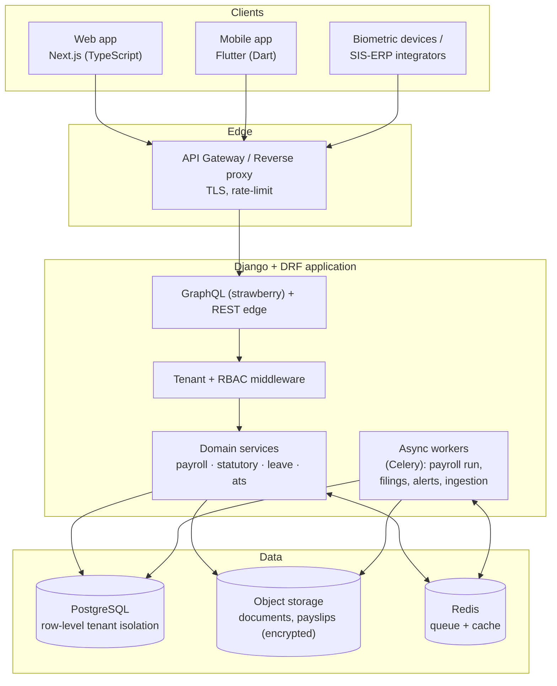
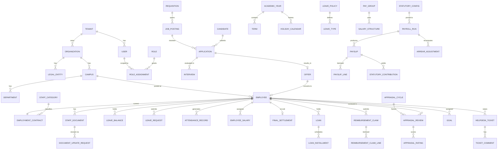
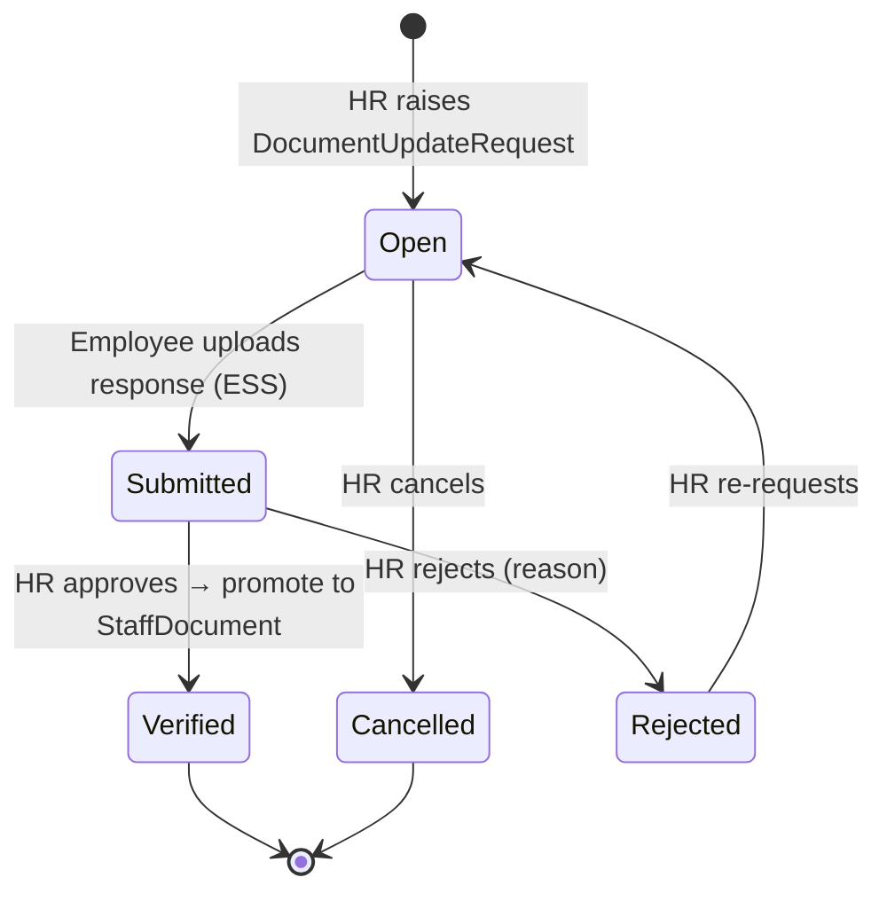
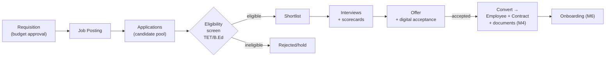
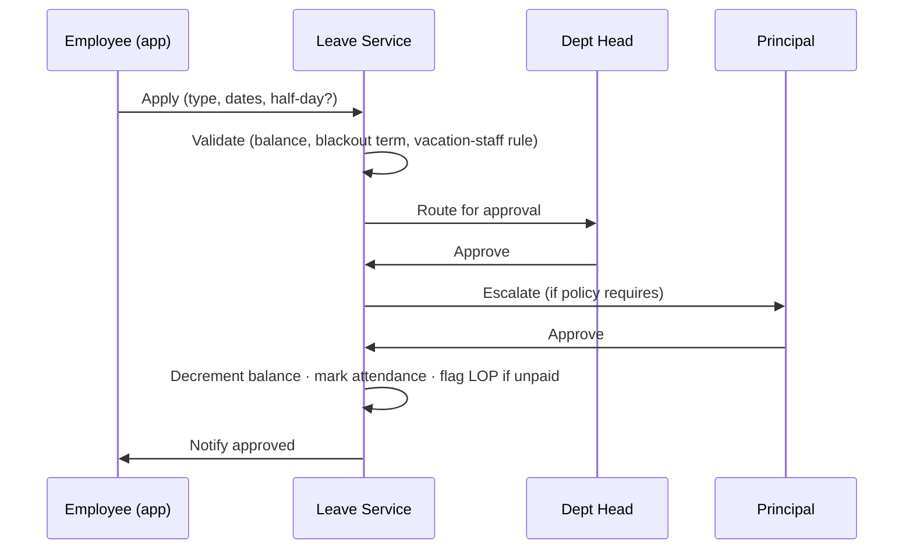
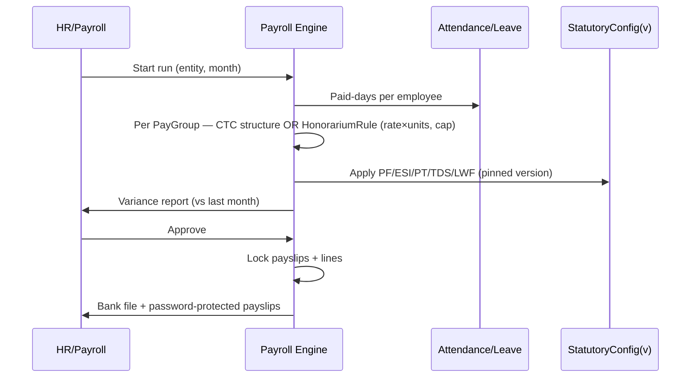
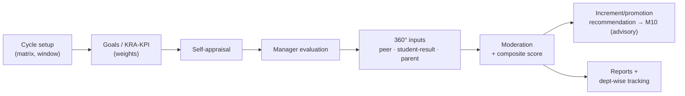

# Development Specification — Naveya (School HRMS)

> **Audience & purpose.** This is the authoritative build document for engineering the MVP. It is
> self-contained: architecture, the full data model, per-module functional + technical specifications,
> workflows, the API surface, security, non-functional requirements, testing, and a sprint-by-sprint
> build plan. A business reader can follow Parts I and III's "Purpose" and workflow narratives; engineers
> should read everything.
>
> This document supersedes the earlier `foundation-and-workflows.md` (its content is folded in and
> extended here). Scope is governed by `functionality-blueprint.md` (MVP / Phase 2 / Later) and the locked
> decisions in `decisions-to-finalize.md`.
>
> **Recent scope changes (2026-07-15):** (1) **Recruitment/ATS is in the MVP.** (2) **HR-controlled document
> governance** — HR uploads staff documents at enrollment; employees cannot self-update; changes flow only
> through an HR-initiated request → employee upload → HR verification.
>
> **Recent scope changes (2026-07-22 — "ShriConnect alignment"):** Five modules move from Phase 2 **into
> MVP**. (1) **Performance Appraisal / PAMS** becomes a new module, **M17** — goal/KRA-KPI, self +
> manager review, 360° feedback, configurable appraisal cycles + rating matrix, increment/promotion
> recommendation, performance reports + department-wise tracking, plus education extras
> (classroom-observation/peer review, student-result/outcome linkage); student/parent 360° and UGC-API scoring
> stays **Later** and CPD/in-service training-hours stay **Phase 2**. (2) **Loans & Advances**,
> (3) **Reimbursements / FBP**, and (4a) **Arrears & retrospective pay-revision** fold into **M10 Payroll**;
> (4b) **Statutory / ex-gratia Bonus** folds into **M11 Statutory** (config-driven via the versioned
> `StatutoryConfig`, never hardcoded). (5) **HR Helpdesk / ticketing & grievance** folds into **M15
> Reporting & Platform**. **M13 ESS/Mobile** gains reimbursement-claim submission and helpdesk-ticket raise.
> All financial finalizations (arrears runs, bonus runs, reimbursement payout batches) carry the
> **maker-checker** gate; appraisal records are **append-only** and audited.

---

# PART I — OVERVIEW & ARCHITECTURE

## 1. Product scope (MVP)

**Naveya** — *nava* (new) + *nāv* (vessel / to navigate), "a new vessel that carries a school's people
forward" — is a compliance-grade Indian staff-payroll HRMS **built for schools**, targeting **private,
multi-branch K-12 groups** first, delivered as **multi-tenant SaaS** with a **single-tenant on-premise**
option for enterprise. Tagline: *Naveya — AI-powered HRMS, built by schools, for schools.* Naveya is built
by **Voxturr Labs** in collaboration with **ShriConnect**, the technology arm of The Shri Ram Schools group.

**MVP modules** (full detail in Part III):

| # | Module | One-line |
|---|---|---|
| M1 | Organization & Tenancy | Tenant → group → trust → campus → department; the isolation boundary |
| M2 | Identity, Roles & Access | Login, RBAC = permission × scope (group/campus/department) |
| M3 | Core HR — People | Staff master, education staff taxonomy, contracts, vacation-staff flag, service book |
| M4 | Document Management & Verification | HR-uploaded, request-gated employee updates, verification, expiry alerts |
| M5 | Recruitment / ATS | Requisition → posting → pipeline → interview → offer → convert to employee |
| M6 | Onboarding | Seasonal/academic-year contracts, checklists, candidate carry-over |
| M7 | Academic Calendar | Academic year, terms, vacation periods, holiday calendars |
| M8 | Leave | Academic-calendar cycle, vacation-staff logic, approvals, LOP linkage |
| M9 | Attendance | Biometric + geo/selfie mobile, shifts, half-day, paid-days reconciliation |
| M10 | Payroll | Multi-scale (CTC + honorarium), LOP proration, variance review, bank file |
| M11 | Statutory Compliance | PF/ESI/PT/TDS/gratuity/bonus/LWF + filings (ECR, 24Q, Form 16) |
| M12 | Full & Final Settlement | Leave encashment, gratuity, recoveries, TDS true-up |
| M13 | Employee Self-Service & Mobile | Phone-first: leave, attendance, payslip, doc-request responses |
| M14 | Notifications & Alerts | Multi-channel: approvals, expiries, statutory due dates |
| M15 | Reporting & Platform | Standard reports, audit log, dashboards |
| M16 | Integrations | Biometric devices, SMS/email, accounting export, webhooks |
| M17 | Performance Appraisal / PAMS | Goal/KRA-KPI, self + manager review, 360° feedback, cycles + rating matrix, increment/promotion recs, department-wise reports + education extras |

**Explicitly Phase 2+ (schema-ready, not built):** substitute-teacher arrangement, period-level
attendance/leave, timetable import, teaching-load, pay-commission/UGC engine, UGC-API appraisal scoring,
CPD/in-service training-hours tracking, travel-request/mileage, deep SIS integration. See the roadmap in
`functionality-blueprint.md`.

## 2. System architecture

**Stack (locked):**

| Concern | Choice | Rationale |
|---|---|---|
| Backend | **Django + Django REST Framework** | Batteries-included (admin, auth, ORM, migrations); ideal for a small team |
| Database | **PostgreSQL** | Row-level security for tenant isolation; JSONB for versioned statutory config; strong integrity |
| Async | **Celery + Redis** | Payroll runs, statutory filing generation, device ingestion, scheduled alerts |
| Object storage | S3-compatible (SaaS) / local encrypted volume (on-prem) | Documents, payslips, Form 16 — encrypted at rest |
| Web | **Next.js (React/TypeScript)** | SSR-capable admin/HR console |
| Mobile | **Flutter (Dart)** | One codebase, phone-first ESS |
| API layer | **strawberry-django GraphQL (primary) + DRF REST edge** | GraphQL SDL + OpenAPI both → generated TypeScript + Dart clients |
| Auth | JWT (access + refresh) | Stateless; works across web + mobile |

## 3. Multi-tenancy & deployment

- **Tenant = one customer account (SaaS) or one whole install (on-prem).** The tenant boundary sits
  **above** the `group → trust → campus → department` hierarchy.
- **Isolation:** every table (except `Tenant`) carries `tenant_id`. Enforcement is layered:
  1. A Django base model + manager that auto-filters by the request's tenant.
  2. Request middleware resolves the tenant (from JWT claim / subdomain) and sets a Postgres session var.
  3. **PostgreSQL Row-Level Security** policies keyed on that session var as a defence-in-depth backstop —
     even a query that forgets the filter cannot cross tenants.
- **On-prem = the identical image** deployed with a single tenant (`deployment_mode='on_prem'`); no code fork.
- **Scaling** is per-tenant/per-campus; the largest single group sets the ceiling, not the SaaS population.

## 4. Cross-cutting foundations

These are built **first** and every module depends on them.

### 4.1 RBAC — permission × scope
Authorization is two-dimensional: **what** (a permission like `leave.approve`) × **where** (a scope:
group / campus / department + id). A `RoleAssignment` binds a user to a role at a scope. Every API request
is filtered to the union of the caller's scoped assignments. **Field-level PII permissions** (bank, PAN,
Aadhaar, salary) are separate from record access.

### 4.2 Audit — immutable trail
Every mutating action writes an `AuditLog` (actor, action, entity, before/after, timestamp). Mandatory and
non-bypassable for payroll runs, statutory filings, approvals, document changes, and master-data edits.

### 4.3 Effective-dating
Records that change over time and must retain history (salary, statutory config, contracts) are **never
edited in place** — a new dated row supersedes the old. One consistent pattern, reused everywhere.

### 4.4 Versioned statutory config
`StatutoryConfig` is an immutable, versioned snapshot of all rates/ceilings/slabs. Each `PayrollRun` pins
the version it used, so a mid-year rule change never corrupts past payrolls. Statutory numbers live in
data, never in code.

### 4.5 Document governance principle
Employee documents are **HR-owned**. HR uploads at enrollment (or they arrive via ATS conversion).
**Employees have no direct write path** to their documents; the only way an employee supplies/updates a
document is by responding to an **HR-initiated `DocumentUpdateRequest`**, after which HR **verifies**. This
is enforced at the API/permission layer, not just the UI. Full detail in Module M4.

### 4.6 Notifications
A channel-agnostic `Notification` service (in-app, push, SMS, email; WhatsApp later) used by approvals,
document requests, expiry alerts, statutory due dates, and payslip release.

---

# PART II — DATA MODEL

## 5. Entity-relationship overview

## 6. Entity catalog

Every entity carries `id`, `tenant_id`, `created_at`, `updated_at` (omitted below for brevity). Enumerated
values shown in `code(...)`.

### 6.1 Tenancy & organization
| Entity | Key fields | Notes |
|---|---|---|
| **Tenant** | name, deployment_mode `(saas/on_prem)`, status, data_region | Isolation boundary; no `tenant_id` on itself |
| **Organization** | org_id, name | The group/society |
| **LegalEntity** | org_id, name, registration_type `(trust/society/sec8)`, pan, tan, pf_estab_id, esi_code, reg_12a | Employer of record; statutory returns file here |
| **Campus** | org_id, legal_entity_id, name, address, **state**, timezone | State drives PT/LWF/min-wage |
| **Department** | campus_id, name, type `(academic/admin/transport/hostel/…)` | |

### 6.2 Identity & access
| Entity | Key fields | Notes |
|---|---|---|
| **User** | email/phone, password_hash, employee_id (nullable), is_active, mfa | Login identity |
| **Role** | name, permission_set (JSON), is_system | e.g. GroupAdmin, Principal, HROperator, Employee |
| **RoleAssignment** | user_id, role_id, scope_level `(group/campus/department)`, scope_id | Two-dimensional RBAC binding |

### 6.3 People
| Entity | Key fields | Notes |
|---|---|---|
| **Employee** | campus_id, department_id, emp_code, name, dob, gender, contact, **pan, aadhaar(masked), uan, esic_no, bank(enc)**, photo, status | PII encrypted + field-permissioned |
| **StaffCategory** | name, kind `(teaching/non_teaching/support/guest)`, min_qualification | Drives eligibility |
| **EmploymentContract** | employee_id, staff_category_id, employment_type `(permanent/probation/contract/visiting)`, **is_vacation_staff**, doj, confirmation_date, contract_end_date, pay_group_id, notice_period, status | Center of gravity — vacation flag + auto-expiry |
| **ServiceRecord** | employee_id, event_type `(joined/confirmed/promoted/transferred/revised/exited)`, effective_date, details | Immutable career timeline; feeds gratuity |

### 6.4 Documents & verification (M4)
| Entity | Key fields | Notes |
|---|---|---|
| **StaffDocument** | employee_id, doc_type `(degree/bed/tet/police_verif/license/aadhaar/pan/…)`, file_ref(enc), issued_on, **expires_on**, **verification_status `(pending/verified/rejected)`**, uploaded_by_user_id, source `(hr_upload/ats_import/request_response)` | HR-owned; employees never write directly |
| **DocumentUpdateRequest** | employee_id, doc_type, reason, requested_by_user_id (HR/admin), status `(open/submitted/verified/rejected/cancelled)`, due_date, response_file_ref, verified_by_user_id, notes | **The only channel** by which an employee supplies/updates a document |

### 6.5 Recruitment / ATS (M5)
| Entity | Key fields | Notes |
|---|---|---|
| **Requisition** | campus_id, department_id, staff_category_id, title, headcount, budget_ctc, justification, status `(draft/pending_approval/approved/rejected/closed)`, approval_chain (JSON) | Budget-based approval routing |
| **JobPosting** | requisition_id, channel `(career_site/board/referral)`, published_at, closes_at | |
| **Candidate** | name, email, phone, resume_ref, **qualifications (JSON)**, source | De-duplicated talent pool |
| **Application** | candidate_id, job_posting_id, stage `(applied/screening/shortlisted/interview/offer/hired/rejected)`, **eligibility_flags (JSON)**, notes | Pipeline; eligibility = TET/CTET/NET/B.Ed screening |
| **Interview** | application_id, round, scheduled_at, panel (JSON), **scorecard (JSON)**, outcome | |
| **Offer** | application_id, ctc, pay_group_id, join_date, status `(draft/sent/accepted/declined/expired)`, letter_ref, accepted_at | Digital acceptance |
| *(conversion)* | Offer `accepted` → creates **Employee** + **EmploymentContract**, and **carries the candidate's documents into StaffDocument** (source=`ats_import`, verification_status=`pending`) | Feeds M4 governance |

### 6.6 Academic foundation (M7)
| Entity | Key fields | Notes |
|---|---|---|
| **AcademicYear** | scope (campus/org), label, start_date, end_date, is_current | Leave reference frame |
| **Term** | academic_year_id, name, start_date, end_date, type `(teaching/exam/vacation)` | Vacation terms drive teacher leave |
| **HolidayCalendar** | campus_id, academic_year_id, name | Per-campus |
| **Holiday** | calendar_id, date, name, type `(national/festival/restricted/floating)` | |

### 6.7 Leave (M8)
| Entity | Key fields | Notes |
|---|---|---|
| **LeavePolicy** | scope, academic_year_id, name | Tied to an academic year |
| **LeaveType** | policy_id, code `(EL/CL/SL/COMP/DUTY/MAT/LOP)`, accrual_rule (JSON), carry_forward_cap, encashable, **applies_to_vacation_staff**, allows_half_day | Vacation-staff-aware |
| **LeaveBalance** | employee_id, leave_type_id, academic_year_id, opening, accrued, used, balance | Per-AY ledger |
| **LeaveRequest** | employee_id, leave_type_id, from_date, to_date, is_half_day, day_count, reason, status, approval_chain (JSON) | Updates balance + LOP |

### 6.8 Attendance (M9)
| Entity | Key fields | Notes |
|---|---|---|
| **Shift** | campus_id, name, start/end, type `(fixed/flexi/rotating)`, grace_minutes | Rosters |
| **AttendanceRecord** | employee_id, date, shift_id, first_in, last_out, source `(biometric/mobile/web)`, geo, selfie_ref, status `(present/absent/half_day/leave/holiday/weekly_off)`, worked_hours | One/day; half-day in MVP |
| **Regularization** | attendance_id, requested_status, reason, approval_chain, status | Corrections |

### 6.9 Payroll (M10)
| Entity | Key fields | Notes |
|---|---|---|
| **PayGroup** | legal_entity_id, name, kind `(ctc_monthly/contract/honorarium)` | Parallel pay logics |
| **SalaryStructure** | pay_group_id, name, effective_from | Component template |
| **PayComponent** | structure_id, code `(BASIC/DA/HRA/SPL/…)`, calc_type `(flat/percent/formula)`, value, taxable, pf_applicable, esi_applicable | Enforces 50%-allowance rule |
| **EmployeeSalary** | employee_id, structure_id, ctc, effective_from | Effective-dated; revisions add rows |
| **HonorariumRule** | pay_group_id, unit `(lecture/period/day)`, rate, monthly_cap | Guest/substitute pay |
| **PayrollRun** | legal_entity_id, period, status `(draft/variance_review/approved/disbursed)`, statutory_config_id | Pins config version |
| **Payslip** | payroll_run_id, employee_id, paid_days, gross, deductions, net, is_locked | Password-protected PDF |
| **PayslipLine** | payslip_id, component_code, amount, type `(earning/deduction/employer_contrib)` | Itemised |
| **Loan** | employee_id, kind `(loan/advance)`, principal `(Decimal)`, interest_rate `(Decimal)`, is_perquisite, emi_amount `(Decimal)`, tenure_months, start_period, status `(pending_approval/active/closed/foreclosed)`, approval_chain (JSON) | Amounts are **Decimal**; auto-deducts via payroll; closes/recovers on exit (feeds M12 F&F `loan_recovery`) |
| **LoanInstallment** | loan_id, seq, due_period, principal_component `(Decimal)`, interest_component `(Decimal)`, balance `(Decimal)`, status `(scheduled/deducted/waived/skipped)`, payslip_line_id | EMI schedule row; deduction lands as a PayslipLine |
| **ReimbursementClaim** | employee_id, category `(lta/medical/telephone/books_academic/fuel)`, amount `(Decimal)`, tax_treatment `(taxable/exempt/fbp)`, status `(draft/submitted/approved/rejected/paid)`, approval_chain (JSON), payroll_run_id (payout batch) | FBP/reimbursement; paid via payroll; receipt files via REST edge |
| **ReimbursementClaimLine** | claim_id, description, amount `(Decimal)`, receipt_ref(enc), incurred_on | Itemised claim lines with receipt uploads |
| **ArrearAdjustment** | employee_id, source `(pay_revision/da_vda/promotion/correction)`, affected_period, delta_amount `(Decimal)`, statutory_config_id, recompute (JSON: PF/ESI/TDS deltas), payroll_run_id, status `(pending_checker/approved/posted)` | Month-split retro pay-revision; each affected month recomputes on its **originally pinned** `StatutoryConfig`; maker-checker before posting |

### 6.10 Statutory (M11)
| Entity | Key fields | Notes |
|---|---|---|
| **StatutoryConfig** | version, effective_from, rules (JSON: PF rate+ceiling, EPS cap, ESI rate+ceiling+periods, PT slabs per state, TDS slabs old/new, gratuity formula, bonus %/caps, LWF per state, min-wage) | Immutable, versioned |
| **StatutoryContribution** | payslip_id, kind `(pf/esi/pt/tds/lwf/bonus)`, employee_amt `(Decimal)`, employer_amt `(Decimal)`, base_amount `(Decimal)` | Rolls up into filings; **bonus** %/calc-cap/eligibility-ceiling read from the pinned `StatutoryConfig` (never hardcoded), incl. ex-gratia/festival bonus where the §32 educational-institution exemption applies |
| **StatutoryFiling** | legal_entity_id, kind `(ecr/esi_return/pt_challan/form_24q/form_16)`, period, artifact_ref, status | Government artefacts |
| **InvestmentDeclaration** | employee_id, financial_year, regime `(old/new)`, declarations (JSON), proofs | Drives TDS §192 |

### 6.11 Exit & platform (M12, M14, M15)
| Entity | Key fields | Notes |
|---|---|---|
| **FinalSettlement** | employee_id, last_working_day, leave_encashment, gratuity, notice_recovery, loan_recovery, tds_trueup, net_payable, status | F&F engine |
| **Notification** | recipient, channel `(in_app/push/sms/email)`, template, payload, status | Multi-channel |
| **AuditLog** | actor_user_id, action, entity, entity_id, before/after (JSON), timestamp | Immutable, read-only |
| **HelpdeskTicket** | raised_by_user_id, category `(it/hr/payroll/facilities/grievance/…)`, subject, body, priority, assignee_user_id, sla_due_at, status `(open/assigned/in_progress/resolved/closed/reopened)` | Raised from ESS/mobile; auto-assignment + SLA/TAT tracking; grievance category is access-restricted |
| **TicketComment** | ticket_id, author_user_id, body, is_internal, attachment_ref | Threaded updates; internal notes hidden from the raiser |

### 6.12 Performance Appraisal / PAMS (M17)
| Entity | Key fields | Notes |
|---|---|---|
| **AppraisalCycle** | scope (campus/org), academic_year_id, name, type `(term/annual/probation)`, rating_matrix (JSON), window_start, window_end, status `(draft/open/locked/closed)` | Configurable cycles + rating matrix; tied to the academic year |
| **Goal** | employee_id, appraisal_cycle_id, kind `(kra/kpi/objective)`, description, weight, target, self_rating, manager_rating, status | Goal/KRA-KPI setting; weights drive the composite score |
| **AppraisalReview** | employee_id, appraisal_cycle_id, reviewer_user_id, stage `(self/manager/360/moderation)`, composite_score, recommendation `(none/increment/promotion/pip)`, status `(pending/submitted/moderated/finalized)` | Self + manager review + 360°; increment/promotion recommendation feeds M10 salary revision (advisory, not auto-applied) |
| **AppraisalRating** | review_id, competency_or_goal_ref, source `(self/manager/peer/student/parent)`, score, comments | 360° incl. classroom-observation/peer, student-result/outcome linkage, student/parent feedback; append-only once submitted |

---

# PART III — MODULE SPECIFICATIONS

Each module follows the same template: **Purpose · Actors · Entities · Business rules · Workflow(s) ·
API · Permissions · Acceptance criteria.**

## M1 — Organization & Tenancy

**Purpose:** Model a customer's structure and enforce isolation. **Actors:** Group Admin (setup), platform (isolation).
**Entities:** Tenant, Organization, LegalEntity, Campus, Department.
**Business rules:** every record is tenant-scoped; campus carries `state` (statutory driver); a legal entity
groups campuses for payroll/filing; on-prem = single tenant.
**API:** `GET/POST/PATCH …/organizations|legal-entities|campuses|departments`.
**Permissions:** `org.manage` at group scope (Group Admin only).
**Acceptance:** a Group Admin can create a group with ≥2 campuses in different states; no query returns
another tenant's rows (verified by an RLS cross-tenant test).

## M2 — Identity, Roles & Access

**Purpose:** Authentication + two-dimensional authorization. **Actors:** all users; Group/Campus admins manage roles.
**Entities:** User, Role, RoleAssignment.
**Business rules:** permission × scope on every request; field-level PII permissions distinct from record
access; JWT access+refresh; optional MFA for admin/payroll roles; maker-checker capability flag on roles.
**Seed roles:** Group Admin, Campus Principal, HR Operator, Payroll Operator, Accountant, Department Head, Employee.
**API:** `POST /auth/login|refresh`, `GET /me`, `…/roles`, `…/role-assignments`.
**Permissions:** `iam.manage` (group/campus scope).
**Acceptance:** a Principal scoped to Campus A cannot read Campus B data; a Department Head can approve
leave but cannot see bank details unless granted the PII permission.

## M3 — Core HR (People)

**Purpose:** The staff system of record. **Actors:** HR Operator, Principal, Employee (read-only self).
**Entities:** Employee, StaffCategory, EmploymentContract, ServiceRecord.
**Business rules:** `is_vacation_staff` and `contract_end_date` live on the contract; salary/leave/attendance
all derive behaviour from the contract; PII encrypted; every lifecycle change writes a ServiceRecord.
**Workflow — teacher onboarding (also see M6):** create Employee → contract (category, vacation flag,
end-date) → salary assignment → leave-balance init → user invite → ServiceRecord `joined`.
**API:** `…/employees`, `…/employees/{id}/contracts`, `…/staff-categories`.
**Permissions:** `people.manage` (campus scope); `people.read` for managers; PII gated by `people.pii.read`.
**Acceptance:** onboarding a PGT with `is_vacation_staff=true` initialises leave balances that exclude/reduce EL.

## M4 — Document Management & Verification  ★ (governance model)

**Purpose:** Keep staff documents **HR-owned and verified**, with a controlled channel for employee updates.
**Actors:** HR Operator/Admin (upload, request, verify), Employee (respond only).

**Entities:** StaffDocument, DocumentUpdateRequest.

**Business rules (enforced at API/permission layer, not just UI):**
1. HR/admin uploads documents at enrollment (or they arrive via ATS conversion, `source=ats_import`).
2. **An employee has NO direct create/update path to `StaffDocument`.** The `documents.write` permission is
   not granted to the Employee role.
3. The **only** way an employee supplies/changes a document is by responding to an **HR-initiated
   `DocumentUpdateRequest`**. The employee's upload lands as the request's `response_file_ref` — it does
   **not** overwrite the live document until HR verifies.
4. HR **verifies** (`verified`) → the response is promoted to a `StaffDocument` (new/replacement) with
   `verification_status=verified`; or **rejects** (`rejected`) with a reason → employee may be asked again.
5. Every state change is audited; expiry alerts (M14) watch `expires_on`.

**Workflow — document update (state machine):**

**API:**
- HR: `POST …/employees/{id}/documents` (upload), `POST …/document-requests` (raise),
  `POST …/document-requests/{id}/verify`, `POST …/document-requests/{id}/reject`, `…/cancel`.
- Employee (ESS): `GET …/me/document-requests`, `POST …/me/document-requests/{id}/respond` (upload only,
  only when status=`open`). **No** `PATCH /me/documents`.

**Permissions:** `documents.manage`, `documents.verify` (HR/admin, campus scope); Employee has only
`documents.request.respond` scoped to self.

**Acceptance:**
- An Employee calling any document write endpoint outside an open request → **403**.
- HR raises a request → employee uploads → live document unchanged until HR verifies → on verify, the new
  file becomes the current `StaffDocument` and the old is retained in history.
- All transitions appear in the audit log.

## M5 — Recruitment / ATS  ★ (now MVP)

**Purpose:** Hire teaching/admin staff end-to-end and convert hires into the staff record without re-keying.
**Actors:** HR Operator/Recruiter, Interview Panel, Approver (Principal/Group Admin), Candidate (public).

**Entities:** Requisition, JobPosting, Candidate, Application, Interview, Offer.

**Business rules:**
- Requisition needs budget-based approval (chain by amount/scope) before posting.
- **Eligibility screening:** applications are flagged against category qualification norms (TET/CTET/NET/B.Ed)
  at shortlist; ineligible candidates are marked, not silently dropped.
- Interview scorecards drive an outcome; offer carries CTC + `pay_group_id` + join date.
- **Offer acceptance auto-creates Employee + EmploymentContract and carries documents into M4** (as
  `pending` verification). No double data entry.

**Workflow — hire-to-onboard pipeline:**

**API:** `…/requisitions` (+ `/approve`), `…/job-postings`, `…/candidates`, `…/applications`
(+ `/advance`, `/reject`), `…/interviews` (+ `/scorecard`), `…/offers` (+ `/send`, `/accept`), public
`POST /careers/{posting}/apply`.
**Permissions:** `ats.manage` (campus/group), `ats.approve` (approver), public unauthenticated apply.
**Acceptance:** an approved requisition → posting → application flagged eligible → interview → offer →
acceptance creates a linked Employee whose documents appear in M4 as `pending`.

## M6 — Onboarding

**Purpose:** Convert an accepted hire (or a directly-added joiner) into an active, paid employee.
**Business rules:** supports **seasonal bulk** onboarding and **academic-year fixed-term contracts with
auto-expiry**; checklist tasks (documents, assets, induction); session-end **renewal/non-renewal** workflow.
**Workflow:** candidate/HR data → contract → document capture (M4) → leave init (M8) → user invite → checklist.
**API:** `…/onboarding-tasks`, bulk `POST …/employees:bulk`.
**Permissions:** `people.manage`. **Acceptance:** a fixed-term contract auto-expires at `contract_end_date`
and surfaces in the renewal queue.

## M7 — Academic Calendar

**Purpose:** The session/term/vacation frame that leave and (Phase 2) substitution depend on.
**Entities:** AcademicYear, Term, HolidayCalendar, Holiday.
**Business rules:** one `is_current` AY per scope; vacation terms feed teacher leave logic; holiday calendars
are per-campus (state/festival variance). **API:** `…/academic-years|terms|holiday-calendars|holidays`.
**Permissions:** `calendar.manage` (campus/group). **Acceptance:** creating AY 2026-27 with a summer
vacation term makes vacation-staff leave rules apply in that window.

## M8 — Leave

**Purpose:** Academic-calendar-driven leave with the vacation-staff distinction. **Actors:** Employee, HOD, Principal.
**Entities:** LeavePolicy, LeaveType, LeaveBalance, LeaveRequest.
**Business rules:** balances keyed to `academic_year_id`; `LeaveType.applies_to_vacation_staff` gates EL for
teachers; exam/admission **blackout** validation against `Term`; approved paid leave → `AttendanceRecord`
status; unpaid/exhausted → **LOP into payroll**; half-day supported; comp-off for holiday work.

**Workflow — leave application & approval:**

**API:** `…/leave-types`, `…/leave-balances`, `…/leave-requests` (+ `/approve`, `/reject`, `/cancel`).
**Permissions:** `leave.apply` (self), `leave.approve` (HOD/Principal scope).
**Acceptance:** a teacher (vacation staff) cannot accrue EL; a leave request during an exam term is blocked;
an approved unpaid day reduces payroll paid-days.

## M9 — Attendance

**Purpose:** Multi-source capture → paid-days. **Entities:** Shift, AttendanceRecord, Regularization.
**Business rules:** biometric push + mobile (geo+selfie) + web; nightly job applies shift/grace/holiday rules
→ status + worked_hours; exceptions resolved via Regularization; **paid-days = present + paid-leave +
holidays + weekly-offs − LOP** feeds payroll.
**Workflow:** device/app punch → AttendanceRecord → nightly reconciliation → exceptions → regularization.
**API:** `POST …/attendance/ingest` (service auth), `…/attendance-records`, `…/regularizations`.
**Permissions:** `attendance.read` (self/manager), `attendance.manage` (HR), ingest via service token.
**Acceptance:** a full day's punches reconcile to `present`; a missing punch raises an exception a manager
can regularize; paid-days compute correctly for a mid-month joiner.

## M10 — Payroll

**Purpose:** Run multiple pay logics (CTC + honorarium) with statutory correctness in one entity run,
including loan deductions, reimbursement payouts, and retrospective arrears.
**Entities:** PayGroup, SalaryStructure, PayComponent, EmployeeSalary, HonorariumRule, PayrollRun, Payslip,
PayslipLine, **Loan, LoanInstallment, ReimbursementClaim, ReimbursementClaimLine, ArrearAdjustment**.
**Business rules:** validate excluded allowances ≤ 50% of wages (Labour Code); paid-days proration; effective-
dated salary; per-lecture honorarium with monthly cap; **variance review before approval**; pins
`StatutoryConfig`; locked payslips; NEFT bank file. All monetary fields are **Decimal**, never float.
**Compute vs release *(wording corrected 2026-08-11)*:** payroll **computation** across all pay groups is a
single action with exception/variance auto-detection, but **release — run approval, bank-file generation and
disbursement — always requires a distinct checker and is never one click** (`payroll.approve`; a maker cannot
approve their own run). Any UI or copy implying a "single-click payroll run" through to disbursement
contradicts this rule and §8's maker–checker control.

**Loans & Advances *(ShriConnect scope, 2026-07-22)*:** a Loan carries an EMI schedule (LoanInstallment
rows); interest may be flagged as a perquisite; the active EMI auto-deducts each run as a PayslipLine and
decrements the balance; on exit the outstanding balance flows to M12 F&F `loan_recovery`; foreclosure/waiver
is audited. Loan approval uses `payroll.approve` maker-checker.

**Reimbursements / FBP *(ShriConnect scope, 2026-07-22)*:** claims by category (LTA, medical, telephone,
books/academic allowance, fuel) with per-category tax treatment (taxable/exempt/FBP); submitted with receipts
from ESS/mobile (M13); approval workflow; approved claims are paid out in a **payout batch** attached to a
PayrollRun. The payout batch is a financial finalization → **maker-checker** (`payroll.approve`) required.

**Arrears & retrospective pay-revision *(ShriConnect scope, 2026-07-22)*:** a back-dated salary revision
(DA/VDA, promotion, pay-commission, correction) generates ArrearAdjustment rows that **split by affected
month**, recomputing PF/ESI/TDS for each month **on that month's originally pinned `StatutoryConfig`
version** (never the current one, never hardcoded rates). Arrears post through a run and require
**maker-checker** before posting; adjustments are **append-only** (a correction supersedes, never edits).

**Workflow — monthly run:**

**API:** `…/pay-groups`, `…/salary-structures`, `…/employee-salaries`, `…/payroll-runs`
(+ `/compute`, `/variance`, `/approve`, `/bank-file`), `…/loans` (+ `/approve`, `/foreclose`),
`…/reimbursement-claims` (+ `/approve`, `/reject`), `…/reimbursement-payout-batches` (+ `/approve`),
`…/arrear-adjustments` (+ `/compute`, `/approve`).
**Permissions:** `payroll.run`, `payroll.approve` (maker-checker on runs, loan approval, reimbursement payout
batches, and arrears posting); PII/salary gated.
**Acceptance:**
- A run pays a CTC teacher and a per-lecture guest correctly in one pass; excluded allowances > 50% is
  rejected at structure save.
- An active loan auto-deducts the correct EMI as a PayslipLine and decrements the balance; an unclosed loan's
  outstanding balance appears in the exiting employee's F&F `loan_recovery`.
- A reimbursement claim submitted from mobile with a receipt, once approved, is paid only via a payout batch
  that a **distinct checker** approves (maker-checker); the maker cannot self-approve.
- A back-dated revision produces month-split ArrearAdjustments; each affected month recomputes PF/ESI/TDS on
  **its originally pinned `StatutoryConfig` version**, and posting requires a distinct checker.

## M11 — Statutory Compliance

**Purpose:** Deep, versioned Indian statutory computation + government filings. **Entities:** StatutoryConfig,
StatutoryContribution, StatutoryFiling, InvestmentDeclaration.
**Business rules:** compute PF (ECR, configurable ceiling), ESI (periods rule), PT (per state), TDS §192 (old &
new regime), gratuity (continuous service), bonus, LWF, min-wage; generate ECR, Form 24Q (FVU), Form 16
(Part A+B), Form 12BA (signed); reconciliation + liability provisioning; **config is versioned and pinned per run.**

**Statutory / ex-gratia Bonus *(ShriConnect scope, 2026-07-22)*:** the bonus **percentage (8.33–20%),
calculation cap, and eligibility-wage ceiling are read from the pinned, effective-dated `StatutoryConfig`** —
never hardcoded. The engine notes the **Payment of Bonus Act §32 educational-institution exemption**: where
statutory bonus does not apply, it still supports **ex-gratia / festival bonus** as a configurable payout.
Bonus is computed as a run whose amounts are **Decimal**, rolls up as a `StatutoryContribution(kind=bonus)`,
is **append-only** and audited, and is finalized only through **maker-checker** (`statutory.file` maker +
distinct checker).
**API:** `…/statutory-configs`, `…/statutory-filings` (+ `/generate`), `…/investment-declarations`,
`…/bonus-runs` (+ `/compute`, `/approve`).
**Permissions:** `statutory.manage`, `statutory.file` (maker-checker on bonus runs).
**Acceptance:** changing the PF ceiling creates a new config version; a prior month re-opened still computes
on its original version; Form 24Q validates via FVU; a bonus run reads its %/cap/eligibility from the pinned
`StatutoryConfig` (a config change produces a new version, not an edit) and cannot be finalized by its maker.

## M12 — Full & Final Settlement

**Purpose:** Correct exit settlement. **Entity:** FinalSettlement.
**Business rules:** on exit — pending salary, **leave encashment (§10(10AA))**, **gratuity** (≥5 yrs, from
ServiceRecord continuous service), notice recovery, loan recovery, TDS true-up; final payslip; access revoked.
**Maker-checker is CONFIGURABLE per tenant for F&F *(product decision 2026-08-11)*:** a settlement **may
legitimately be computed and completed by a single person** where the tenant configures it so — small schools
often have one finance person, and an F&F is a single, individually-reviewed settlement rather than a bulk
release. This is a **narrow exception** and does **not** relax the mandatory distinct-checker requirement on
payroll run approval, bank-file generation/disbursement, statutory filings, reimbursement payout batches,
arrears posting or bonus runs (see §8). Whichever mode a tenant chooses, the setting itself is tenant
configuration, every settlement remains fully audited, and any single-person completion is recorded as such.
**API:** `…/final-settlements` (+ `/compute`, `/approve`).
**Permissions:** `payroll.run` + `people.manage`; the second-approver requirement is a tenant setting.
**Acceptance:** a 6-year teacher's F&F includes gratuity and
leave encashment; `User.is_active` flips false on completion; with the tenant's F&F checker requirement
**enabled**, a maker cannot approve their own settlement, and with it **disabled**, single-person completion
succeeds and is audited as single-person.

## M13 — Employee Self-Service & Mobile

**Purpose:** Phone-first employee actions. **Business rules:** leave apply/track, attendance mark (geo/selfie) +
regularize, payslip/Form 16 download, investment declaration, **respond to document-update requests (M4)** —
**no unilateral document self-update**, **submit reimbursement/FBP claims with receipt upload (M10)**,
**raise HR-helpdesk tickets & track SLA (M15)**, manager approvals; native Flutter apps; offline attendance
tolerance; all user-facing copy is Hindi + English via i18n.
**API:** `…/me/*` (profile read, leave, attendance, payslips, document-requests, **reimbursement-claims,
helpdesk-tickets**).
**Permissions:** self-scoped (`reimbursement.submit`, `helpdesk.raise` scoped to self); managers get approval permissions.
**Acceptance:** an employee can respond to a doc request but receives 403 on any direct document write; an
employee can submit a reimbursement claim with a receipt and raise a helpdesk ticket from mobile and see its
status/SLA, but cannot approve their own claim.

## M14 — Notifications & Alerts

**Purpose:** Multi-channel messaging. **Business rules:** in-app/push/SMS/email; scheduled scans for
**document/contract expiry** (lead times) and **statutory due dates**; approval and payslip-release events.
**API:** `…/notifications`, admin templates. **Acceptance:** a licence expiring in 30 days notifies employee + HOD + HR.

## M15 — Reporting & Platform

**Purpose:** Standard reports + audit + dashboards + HR helpdesk. **Business rules:** payroll/attendance/leave/statutory
(audit-ready) reports; campus + group dashboards (headcount, cost, statutory liability); immutable audit log
(read-only). **API:** `…/reports/*`, `…/audit-logs` (read). **Acceptance:** a payroll register reconciles to the
sum of payslips; audit log is append-only.

### M15.1 — HR Helpdesk / Ticketing *(ShriConnect scope, 2026-07-22)*
**Purpose:** A ticketed channel for staff queries and grievances. **Actors:** Employee (raise, from ESS/mobile),
HR/Admin (triage, resolve), assignee.
**Entities:** HelpdeskTicket, TicketComment.
**Business rules:** configurable **ticket categories** (IT/HR/payroll/facilities/grievance/…); **auto-assignment**
by category to an owner/queue; **SLA/TAT tracking** with escalation on breach (via M14 notifications);
**grievance** tickets are access-restricted (confidential handling, PII never logged); internal comments are
hidden from the raiser; every transition is audited.
**Workflow:** raise (ESS) → auto-assign → in_progress (comments) → resolved → closed (or reopened); SLA timer
runs from raise, pauses per policy, and fires an escalation on breach.
**API:** `…/helpdesk-tickets` (+ `/assign`, `/comment`, `/resolve`, `/close`, `/reopen`), ESS `…/me/helpdesk-tickets`.
**Permissions:** `helpdesk.raise` (self), `helpdesk.manage` (HR/admin scope), grievance category gated to a
restricted role. **Acceptance:** a ticket raised from mobile auto-assigns by category, surfaces an SLA due
time, escalates on breach, and its full history is in the audit log; a grievance ticket is not visible to
unauthorized roles.

## M16 — Integrations

**Purpose:** External connectivity. **Business rules:** biometric device families (ZKTeco/eSSL/Matrix/Realtime)
via push/pull ingestion; SMS/email providers; accounting export (Tally); **webhooks** (`employee.created`,
`payroll_run.approved`, `offer.accepted`) for SIS/ERP; OpenAPI + generated clients.
**API:** `…/webhooks`, `POST …/attendance/ingest`. **Acceptance:** a biometric push creates attendance records;
a webhook fires on payroll approval.

## M17 — Performance Appraisal / PAMS  ★ (now MVP)

**Purpose:** Run staff performance appraisal on an education-shaped model — corporate goal/KRA baseline plus
classroom observation, peer review and student-result linkage — feeding increment/promotion
(**student/parent 360° is Later**, not MVP: no student or parent role exists in the product; collection would
require minor-facing accounts with verifiable parental consent under DPDP — corrected 2026-08-11)
recommendations into payroll. *(ShriConnect scope, 2026-07-22.)*
**Actors:** Employee (self-appraisal), Manager/HOD (evaluation), Principal/HR (moderation, cycle setup),
peers/students/parents (360° inputs).

**Entities:** AppraisalCycle, Goal, AppraisalReview, AppraisalRating.

**Business rules:**
- **Configurable appraisal cycles** (term/annual/probation) tied to the academic year, each with a
  **rating matrix**; a cycle opens, locks, then closes.
- **Goal/KRA-KPI** setting with weights; **self-appraisal → manager evaluation → 360° feedback → moderation**.
- **360° sources:** manager, peer, **classroom-observation/peer review**, **student-result/outcome linkage**,
  and **student/parent** feedback. Ratings are **append-only** once submitted (a revision supersedes).
- **Increment/promotion recommendation** is **advisory** — it surfaces to M10 payroll as a proposed
  effective-dated salary revision; it is **never auto-applied** and still passes payroll maker-checker.
- **Performance reports + department-wise tracking**; every transition audited; PII/scores access-scoped;
  all user-facing copy Hindi + English via i18n.
- **Deferred:** UGC-API academic self-appraisal scoring (**Later**); CPD/in-service training-hours tracking
  (**Phase 2**).

**Workflow — appraisal cycle:**

**API:** `…/appraisal-cycles` (+ `/open`, `/lock`, `/close`), `…/goals`, `…/appraisal-reviews`
(+ `/self`, `/manager`, `/moderate`, `/finalize`), `…/appraisal-ratings`, `…/appraisal-reports`.
**Permissions:** `appraisal.manage` (HR/principal, campus/group scope), `appraisal.review` (manager/HOD),
`appraisal.self` (employee, self-scoped), 360°-input permissions scoped per source.
**Acceptance:**
- A configurable annual cycle with a rating matrix runs self-appraisal → manager evaluation → 360° →
  moderation and produces a composite score per employee.
- A promotion/increment recommendation appears in M10 as a **proposed** salary revision that still requires
  payroll maker-checker — it is not auto-applied.
- Department-wise performance reports reconcile to the underlying reviews; submitted ratings are append-only
  and every transition is in the audit log.

---

# PART IV — ENGINEERING

## 7. API design & conventions

> **API layer (decision 2026-07-18): mixed GraphQL + REST.** Primary API is **strawberry-django GraphQL**
> (the read/query surface + most mutations, DataLoader-batched, tenancy-scoped resolvers). A **DRF REST
> edge** serves the cases REST fits better: device/webhook ingestion, file up/download (documents,
> payslips, bank files), OAuth/JWT auth endpoints, and third-party/ERP integration. **Both** feed generated
> clients: the GraphQL SDL → typed operations (TS via graphql-codegen, Dart via graphql codegen), and the
> REST edge → OpenAPI (drf-spectacular) → TS/Dart. This matches the reference stack (recoveryco).

- **Style:** GraphQL-first for app data (schema-driven, batched via DataLoaders); REST for ingestion,
  files, auth, and integrations. Explicit mutations/action endpoints for state transitions
  (`payrollRunApprove`, `POST …/payroll-runs/{id}/approve`) rather than overloaded updates.
- **Contract:** GraphQL SDL (`backend/schema.graphql`) **and** OpenAPI 3 (`drf-spectacular`) are both
  committed sources of truth; CI fails on drift; TypeScript + Dart clients are generated from them (never
  hand-written). The `check-contract-sync` hook flags stale generated clients.
- **Auth:** JWT bearer (access ~15 min, refresh rotating); every request resolves tenant + scoped roles.
- **Tenancy:** tenant is implicit from the token — **never** a request parameter a client can set.
- **Pagination:** cursor-based; **filtering/sorting** via documented query params.
- **Concurrency:** `ETag` + `If-Match` (optimistic) on mutable records; **idempotency keys** required on
  payroll/statutory/settlement actions so a retry never double-processes.
- **Errors:** RFC-7807 problem+json; stable machine-readable `code`; field-level validation errors.
- **Webhooks:** signed (HMAC), retried with backoff, delivered per-tenant.
- **Versioning:** URI major version (`/api/v1/…`); additive changes only within a version.

## 8. Security & data protection (DPDP-aligned)

| Control | Implementation |
|---|---|
| Tenant isolation | ORM base manager + middleware **and** PostgreSQL Row-Level Security backstop |
| Encryption | TLS in transit; DB + object-store encryption at rest; password-protected payslips/Form 16 |
| PII classification | Aadhaar, PAN, bank, salary, background-verification flagged sensitive; access-logged |
| Field-level access | Bank/PAN/Aadhaar/salary visibility is a distinct permission from record access |
| Document governance | Employees cannot write documents; only respond to HR requests (M4) — enforced server-side |
| Consent & retention (DPDP 2023) | Lawful-basis records, retention windows, data-access/correction requests; statutory-retention data survives exit |
| Child-safety | Police/background-verification records access-restricted; expiry alerts prevent lapses |
| Maker–checker | Second-person approval, by a **distinct** user, is **mandatory** on: payroll run approval, bank-file generation/disbursement, statutory filings, reimbursement payout batches, arrears posting and bonus runs. **F&F settlements are the one configurable exception** — per-tenant, they may be completed by a single person (M12, 2026-08-11) |
| Auth hardening | MFA for admin/payroll roles; rate-limiting; lockout; audit of logins |
| On-prem | Single-tenant deployment for data-residency mandates |

## 9. Non-functional requirements

| Area | Target |
|---|---|
| Availability (SaaS) | 99.5%+; payroll/statutory operations idempotent & resumable |
| Performance | Payroll for ~2,000 staff computes in minutes; list/search endpoints paginate and stay responsive per campus |
| Scalability | Scale by tenant/campus; largest single group sets the ceiling |
| Auditability | Every payroll run, filing, approval, document + master-data change captured immutably |
| Localisation | ₹, Indian date/number formats, state-aware statutory, academic-year framing |
| Mobile offline | Attendance degrades gracefully on weak connectivity, syncs on reconnect |
| Maintainability | Boring stack; statutory rules in versioned data, not code |
| Accessibility | Web console WCAG-AA aligned for core HR flows |

## 10. Environments, deployment & CI/CD

- **Environments:** local (Docker Compose) → staging → production (SaaS) + per-customer on-prem bundle.
- **Packaging:** containerised app + workers; the **same image** runs SaaS (multi-tenant) and on-prem
  (single-tenant, `deployment_mode=on_prem`).
- **CI:** lint (ruff/black, eslint) → unit + integration tests → OpenAPI diff/contract check → client-gen →
  migration check. Merge blocked on red.
- **CD:** staging auto-deploy on main; production gated; migrations run as a controlled step.
- **On-prem delivery:** versioned release bundle (compose/helm) + upgrade runbook; statutory-config updates
  ship as data so on-prem customers stay compliant without a full release.
- **Observability:** structured logs, error tracking, payroll/filing job metrics, tenant-scoped dashboards.

## 11. Testing strategy

- **Unit:** pure rules — statutory calculators (PF/ESI/PT/TDS/gratuity), paid-days, honorarium caps,
  50%-allowance validation, leave accrual/vacation-staff logic. These carry the highest test density.
- **Integration:** API + DB with **tenant-isolation tests** (a cross-tenant read must fail against RLS),
  RBAC scope tests, document-governance tests (employee document-write → 403).
- **Workflow/e2e:** hire→onboard→attendance→leave→payroll→statutory→exit happy path on seed data.
- **Contract:** generated clients compile against the live OpenAPI; breaking changes fail CI.
- **Data fixtures:** a realistic multi-campus group with teaching/non-teaching/guest staff and an academic year.
- **Regression guard:** golden-file payroll outputs per statutory-config version so rule changes are intentional.

## 12. Build plan — milestones for ~2 engineers + AI agents

Sequenced so each stage is demoable and depends only on prior stages. Indicative sprints (2 weeks each);
adjust to team velocity.

| Sprint | Milestone | Delivers |
|---|---|---|
| 0 | **Foundations** | Repo, CI, Docker, Django+DRF skeleton, PostgreSQL + **RLS tenant isolation**, JWT auth, OpenAPI pipeline, client-gen |
| 1 | **Tenancy + RBAC (M1–M2)** | Org hierarchy, roles, scoped permissions, audit log, seed roles; admin console shell |
| 2 | **People + Documents (M3–M4)** | Staff master, contracts, vacation-staff flag; **document governance** (HR upload + request-gated updates + verify) |
| 3 | **ATS (M5)** | Requisition→posting→pipeline→interview→offer→**convert to employee w/ documents** |
| 4 | **Onboarding + Calendar (M6–M7)** | Seasonal/academic contracts, checklists; academic year, terms, holiday calendars |
| 5 | **Leave (M8)** | Academic-calendar leave, vacation-staff rules, approvals, blackout, LOP linkage |
| 6 | **Attendance (M9)** | Biometric ingest + mobile geo/selfie, shifts, half-day, paid-days reconciliation |
| 7 | **Payroll core (M10)** | Pay groups, structures, honorarium engine, run + variance + payslips + bank file; **loans & advances (EMI schedules, auto-deduct), reimbursements/FBP claims + payout batches (maker-checker)** |
| 8 | **Statutory (M11)** | PF/ESI/PT/TDS computation + versioned config; ECR, 24Q, Form 16 |
| 9 | **Statutory filings + F&F + arrears/bonus (M10–M12)** | Filing artefacts, reconciliation; full & final settlement; **arrears & retrospective pay-revision (month-split, recompute on originally-pinned config, maker-checker); statutory/ex-gratia bonus run (config-driven, maker-checker)** |
| 10 | **ESS + Mobile (M13)** | Flutter app: leave, attendance, payslip, **document-request responses**, **reimbursement-claim submission + helpdesk-ticket raise**, approvals |
| 11 | **Notifications + Reports + Integrations + Helpdesk (M14–M16, M15.1)** | Alerts, standard reports, webhooks, accounting export; **HR helpdesk backend (categories, auto-assign, SLA/TAT, grievance)** |
| 12 | **Performance Appraisal / PAMS (M17)** | Configurable cycles + rating matrix, goals/KRA, self + manager + 360° reviews, moderation, increment/promotion recommendation → M10 (advisory), dept-wise reports |
| 13 | **Hardening** | Security review, DPDP controls, on-prem bundle, load test, golden-file payroll regression |

**Critical-path risks to front-load:** (1) tenant isolation (Sprint 0 — everything inherits it); (2) the
vacation-staff + academic-year model (Sprint 2/4 — ripples into leave & payroll); (3) versioned statutory
config (Sprint 8 — must be data-versioned from first use; arrears and the bonus run in Sprint 9 depend on it
being version-pinnable per month). These are cheap now, expensive to retrofit.

**ShriConnect-scope sequencing (2026-07-22):** loans/reimbursements ride on payroll core (Sprint 7); arrears
and the bonus run follow the versioned statutory config and F&F (Sprint 9); the ESS surfaces for
reimbursement claims and helpdesk tickets land with the mobile app (Sprint 10) but the helpdesk backend lands
with platform (Sprint 11); Performance Appraisal / PAMS (Sprint 12) is sequenced after People (M3), the
academic calendar (M7), and payroll (M10) because its increment/promotion recommendation feeds a payroll
salary revision.

---

# Appendix — Glossary

Key terms map to the data model; see also §6 (Entity catalog).

- **Tenant** — the isolation boundary; a customer account (SaaS) or a whole on-prem install.
- **Group / Trust / Campus / Department** — the customer's internal hierarchy, *inside* a tenant.
- **Vacation staff** — employment attribute: receives vacations in lieu of earned leave (teachers). Drives leave + pay.
- **Academic year / term** — the session/vacation frame for leave (and Phase-2 substitution).
- **Pay group** — a set of staff sharing a pay logic (CTC / contract / honorarium).
- **Honorarium** — per-lecture/period/day pay for guest/substitute faculty, with monthly caps.
- **Statutory config (versioned)** — immutable snapshot of PF/ESI/PT/TDS/gratuity/bonus/LWF rules, pinned per payroll run.
- **Document update request** — the HR-initiated, verified channel through which an employee may supply/update a document.
- **LOP** — Loss of Pay; unpaid days that reduce salary.
- **F&F** — Full & Final settlement on exit (leave encashment + gratuity + recoveries + TDS true-up).
- **Loan / advance** — staff borrowing repaid via an EMI schedule auto-deducted through payroll; outstanding balance recovers at F&F.
- **Reimbursement / FBP** — flexible-benefit/expense claims (LTA, medical, telephone, books/academic, fuel) paid out via a payroll payout batch, tax-treated per category.
- **Arrears** — retrospective pay-revision amounts, month-split and recomputed for PF/ESI/TDS on each month's originally pinned statutory config.
- **Statutory / ex-gratia bonus** — Payment-of-Bonus-Act bonus (%/cap/eligibility from versioned StatutoryConfig); ex-gratia/festival bonus where the §32 educational-institution exemption applies.
- **PAMS** — Performance Appraisal & Management System (M17): cycles, goals/KRA, self + manager + 360° reviews, increment/promotion recommendations.
- **Helpdesk ticket** — a categorized, SLA-tracked staff query/grievance raised from ESS/mobile (M15.1).
